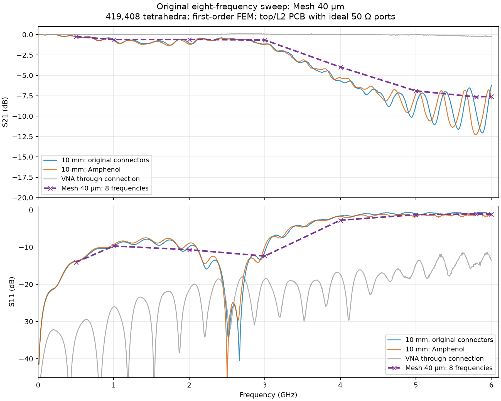

# Mesh 40 µm: eight-frequency EM sweep

This is the archived first completed sweep: **Mesh 40 µm**, 419,408 tetrahedra, eight frequencies. Its purple curve is Mesh 40 µm only; see ../../../../../Notes/FunRad/Frontend/Coupon/01_PCB_ONLY_RESULTS.md for the separate Mesh 60 µm sweep.

Pure PCB model: original pads and tapers, ideal 50 Ω lumped ports; no SMA bodies, pins or solder.

FEM order: **1**. Mesh: 419,408 tetrahedra. FR-4 εr=4.5, tanδ=0.02; copper conductivity 58 MS/m.

**This sweep completed successfully.** Comparison with the later Mesh 60 µm sweep at the same eight frequencies gives a maximum change of 0.04 dB in S21 and 0.34 dB in S11. This eight-point sweep did not sample the 2.65 GHz notch. The effect of air-box size has not been checked with a larger box. These are checks of numerical accuracy; they do not mean that the equation solver failed.

| GHz | Simulated S11, dB | Simulated S21, dB | Measured original 10 mm S21, dB |
|---:|---:|---:|---:|
| 0.5 | -14.11 | -0.24 | -0.25 |
| 1 | -9.71 | -0.61 | -0.60 |
| 2 | -10.72 | -0.60 | -1.04 |
| 3 | -12.41 | -0.66 | -1.15 |
| 4 | -2.79 | -3.98 | -5.68 |
| 5 | -1.30 | -6.91 | -8.70 |
| 5.8 | -1.10 | -7.64 | -9.59 |
| 6 | -1.12 | -7.58 | -6.25 |

Measured values in this table are interpolated in dB to the directly solved frequencies. Plot markers are solved points; connecting lines do not resolve resonances between them.

## Interpretation

At 5.8 GHz the simulated incident power divides into **77.6% reflected**, **17.2% transmitted**, and **5.2% dissipated or radiated**. Most of the transmission reduction in this model is therefore mismatch.

The pure PCB reproduces a substantial high-frequency transmission drop and strong reflection with the specified εr=4.5 and tanδ=0.02. This supports PCB pad/transition mismatch as a major contributor; these measurements alone do not establish unusually high substrate loss. A uniform-line control simulation is still needed to isolate the pads from the rest of the PCB.

The model does not reproduce the measured high-frequency ripples. Ideal port location/profile, omitted connector pins and solder, measurement residuals, and numerical approximation limit a quantitative comparison. Agreement with measurements supports the broad trend, but does not replace checking sensitivity to mesh refinement and air-box size.

Maximum complex reciprocity error |S21−S12|: 2.7e-05. Maximum scattering-matrix singular value: 0.995924 (a passive model should be ≤1, within numerical error).

Data: `result_2layer.npz`, `result_2layer.s2p`, `metrics.json`.
