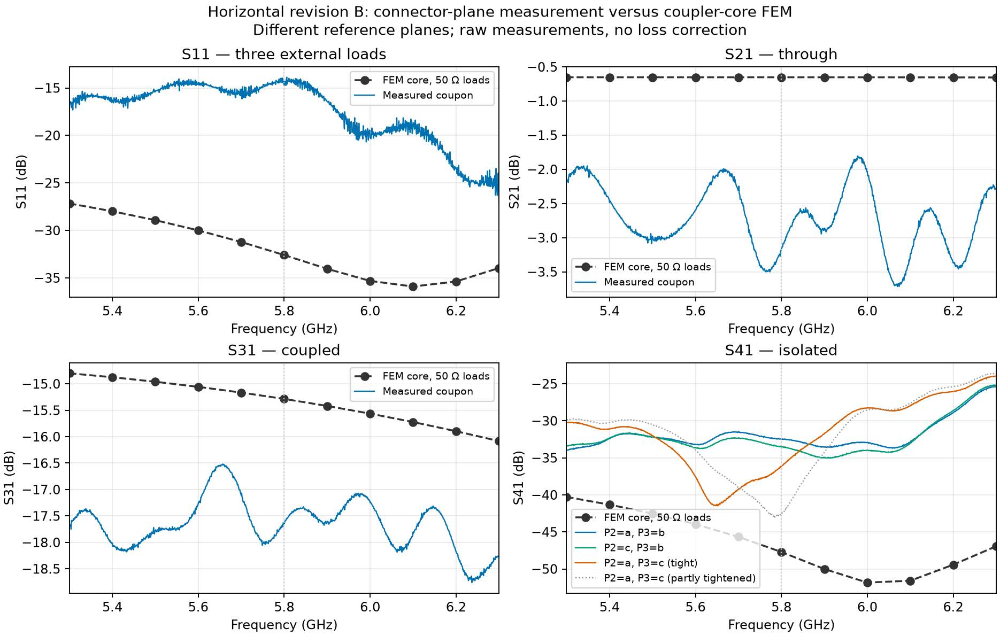
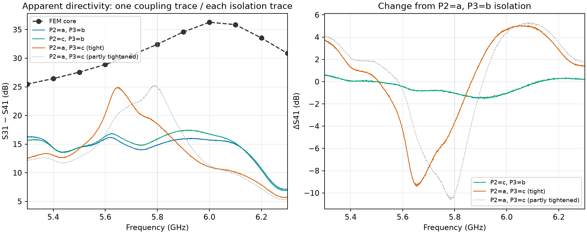
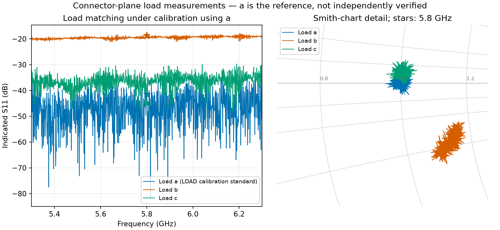
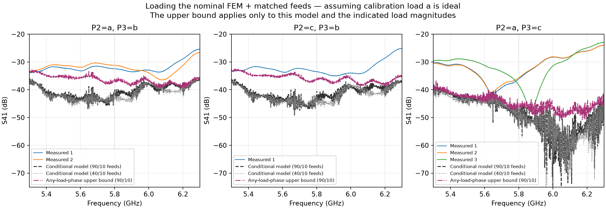
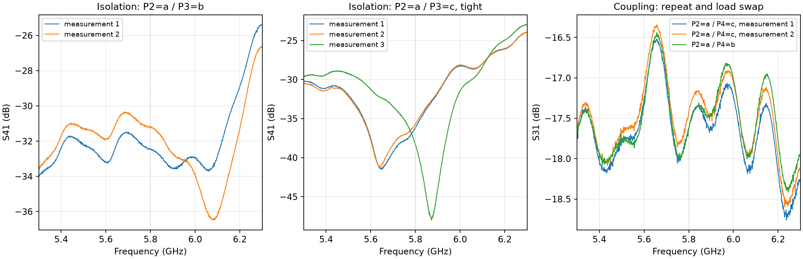
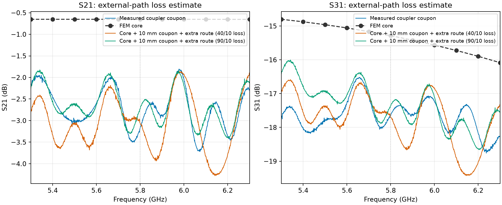
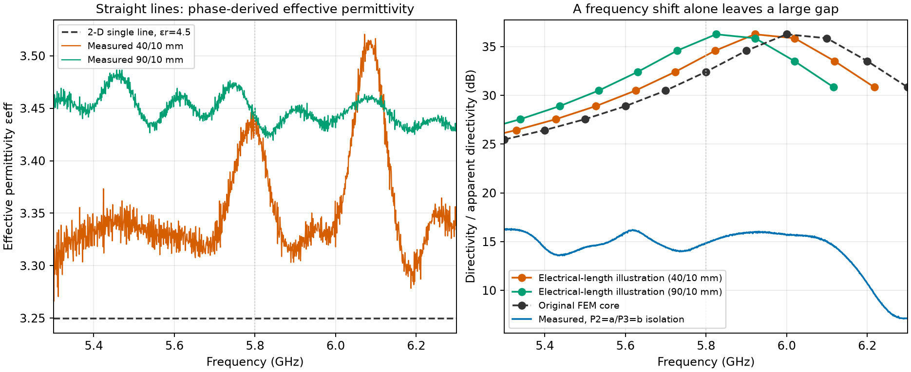

# Coupler — measured versus simulated

**Horizontal revision B, 5.3–6.3 GHz.** The coupler works, but its connector-plane isolation is much poorer than the nominal core simulation. The long feeds explain much of the transmission loss. Load and connection sensitivity prevent us from assigning the remaining isolation error to PCB material alone.

## 1. Raw comparison

| At 5.8 GHz | Measured, dB | FEM core, dB |
|---|---:|---:|
| S11 | -14.75 | -32.59 |
| S21 | -3.16 | -0.65 |
| S31 | -17.65 | -15.29 |
| S41, P2=a / P3=b | -32.46 | -47.71 |

S11 uses **three external terminations**. Each S21/S31/S41 curve is the forward transmission column of its own two-port file: VNA source → coupon P1, receiver → the named output. The zero S12/S22 columns are export placeholders. Port numbering follows [[TX Coupler EM Method]]: P2 through, P3 coupled, P4 isolated.

The FEM is the saved **11-point finite-copper sweep**, εr=4.4, tanδ=0.020, with ideal 50 Ω reference impedances. It includes the coupler and its short fan-outs; the hardware adds long routes and two SMA launches. These raw curves therefore have different reference planes. The measured S11 also includes the launches, feed reflections and imperfect terminations.

## 2. Load matching changes the answer

At 5.8 GHz, isolation is **-32.46 dB** with P2=a/P3=b, **-33.53 dB** with P2=c/P3=b, and **-36.11 dB** with P2=a/P3=c fully tightened. The partly tightened c connection reaches **-42.57 dB**. A deeper dip with a loose connection can come from accidental cancellation; it does not establish better directivity.

Using the available S31 trace, the corresponding **apparent** directivities at 5.8 GHz are **14.82, 15.88, 18.46 dB**, versus **32.42 dB** simulated. The S31 trace uses P2=a/P4=c; it is reused for every ratio, so these are measurement diagnostics rather than several independently measured intrinsic directivities.

Why does a load matter? For excitation at P1, the leading unwanted contributions at P4 are

$$
\widetilde S_{41}\approx S_{41}+S_{42}\Gamma_2 S_{21}+S_{43}\Gamma_3 S_{31}.
$$

Both extra terms can be substantial: the through-arm load sends a reflected wave back into the coupler, and the coupled-arm load reflects the coupled signal towards P4. They add as **complex amplitudes**, so changing their phase can deepen or spoil a null. The exact terminated-network expression is

$$
S_{\mathrm{loaded}}=S_{AA}+S_{AB}\Gamma_B
(I-S_{BB}\Gamma_B)^{-1}S_{BA},
$$

where A contains the two VNA-connected ports and B the two terminated ports. Here Γ is defined at the coupler reference planes; feed lines and adapters transform the physical load reflection. The receiver's own mismatch is an additional uncertainty. [Keysight's measurement-error guide](https://helpfiles.keysight.com/csg/N1930xB/VNACalAndMeas/Errors.htm) describes load-match errors; [Anritsu's directivity explanation](https://www.anritsu.com/en-us/test-measurement/solutions/en-us/understanding-directivity) shows why the termination matters for isolation.

### Measured loads: b differs strongly from the calibration load

The user confirmed calibration **at the load connector**, using **load a for the LOAD step**. The reference plane is appropriate. However, the calibration assumes a is 50 Ω: its near-zero indicated reflection mainly checks reconnection and drift, rather than independently proving its match. Load c is close to a; b differs substantially.

| Load | Indicated S11 at 5.8 GHz, dB | Worst indicated S11 in band, dB |
|---|---:|---:|
| a | -41.36 | -31.82 |
| b | -18.66 | -17.83 |
| c | -44.87 | -29.70 |

These are **indicated** values under that calibration. At 5.8 GHz, b has |Γ|≈0.117, versus 0.006 for c. Thus b can introduce much more reflected signal **if a is a good 50 Ω reference**. The deep minima for a/c should not be treated as independently established 40–80 dB return-loss performance.

### Does measured load mismatch explain the isolation gap?

For an illustration, attach equal **matched** feed networks to the saved FEM core, then terminate P2/P3 using the measured complex reflections in the exact formula above. The feed-pair transfer is

$$
q(f)=S_{21,10}(f)\exp[-\gamma(f)\Delta\ell],\qquad S_{\mathrm{coupon,approx}}=q(f)S_{\mathrm{core}},
$$

where Δℓ=36.85 mm and γ comes from the 40/10 or 90/10 mm pair, with the phase branches already established in the line report. All four feeds are assumed identical. The core's 11 complex samples are linearly interpolated; no new FEM is run. The measured feed transfer includes instrument ripple, so the exact phase of a predicted null is only illustrative.

At 5.8 GHz the 90/10-feed model gives **S41=-40.46 dB for a/b**, **-41.26 dB for c/b**, and **-52.79 dB for a/c**. The magenta line allows **any phase of those same load magnitudes**, including repeated reflections; it bounds the largest leakage within this assumed network. At 5.8 GHz its bounds are **-36.11 / -36.27 / -46.65 dB** for a/b, c/b, a/c. Measurements show more leakage than these conditional bounds at that frequency.

**Under the ideal-a assumption, b explains part of the degradation, but not all of it.** The nominal core plus matched feeds still misses the hardware, particularly a/c. This is not an absolute bound on the real board: unknown error in calibration load a, mismatched launches, VNA receiver match, connection changes and changed core geometry/material are excluded. We cannot uniquely correct the measured directivity from these three load files alone.

The bound follows from replacing each repeated-reflection term by its magnitude. For B={P2,P3}, R=diag(|Γ₂|,|Γ₃|), and elementwise magnitudes,

$$
|\widetilde S_{41}|\le |S_{41}|+|S_{4B}|R(I-|S_{BB}|R)^{-1}|S_{B1}|.
$$

The geometric series converges for every frequency used here. The script checks the bound against the complex prediction and verifies that zero load reflections recover the matched-network S41.

[Load a](../Coupon/measurements/coupler_coupon_revB_7628_horizontal/S11_load_a.s1p) · [Load b](../Coupon/measurements/coupler_coupon_revB_7628_horizontal/S11_load_b.s1p) · [Load c](../Coupon/measurements/coupler_coupon_revB_7628_horizontal/S11_load_c.s1p) · [Load metrics and conditional model samples](assets/measurements/loads_metrics.json)

### Repeatability check

The original files remain the reference for the plots above. The added traces show:

- **S41, P2=a/P3=b:** −32.46 → **-31.20 dB** at 5.8 GHz. Across the band, the median absolute change is **1.16 dB**, with a maximum of **3.47 dB**.
- **S41, P2=a/P3=c, fully tightened:** **−36.11 / -35.66 / -38.34 dB** at 5.8 GHz. Repeat 2 stays within **1.11 dB** of the original across the band; repeat 3 differs by as much as **15.10 dB**, chiefly around the shifted isolation dip.
- **S31, P2=a/P4=c:** −17.65 → **-17.42 dB** at 5.8 GHz; the maximum change across the band is only **0.27 dB**. Swapping P4 to b gives **-17.63 dB** at 5.8 GHz.

**Coupling is substantially more repeatable than isolation.** The isolation changes include both load-dependent differences and variation between connections with the same named loads. The traces alone cannot separate contact changes, cable movement, instrument drift and load mismatch. The load measurements above establish a strong difference between b and the other two, but do not account for all reconnection variation.

## 3. How much is simply feed loss?

The PCB has four equal routed feeds: **25.82 mm** from each SMA signal-pad centre to its coupler pad centre (J7/P1, J9/P2, J8/P3, J10/P4). Their 45° bends are included. The 10 mm reference coupon has a **14.80 mm** pad-centre route. Thus a two-feed path has about **36.85 mm more external route** than that reference. Pad-centre versus FEM-edge offsets are below 0.4 mm per path; this is a loss estimate, not exact de-embedding.

For each straight-line pair, estimate total track attenuation and then add the measured launch pair:

$$
a(f)=-\frac{20\log_{10}|S_{21,\ell}/S_{21,10}|}{\ell-10}\quad[\mathrm{dB/mm}],
$$

$$
S_{j1,\mathrm{estimate}}^{\mathrm{dB}}\approx
S_{j1,\mathrm{core}}^{\mathrm{dB}}+S_{21,10}^{\mathrm{dB}}-a(f)\,(36.85\ \mathrm{mm}),\qquad j=2,3.
$$

Here ℓ is in mm. The measured 40/10 and 90/10 pairs give median attenuation **0.46 and 0.33 dB/cm**. The two coloured curves show how this uncertainty affects the comparison. The core already contains copper and dielectric loss: we add only the external path, rather than applying the coupon attenuation a second time to the core. Using raw 10 mm transmission also carries its measurement ripple into these estimates.

At 5.8 GHz the two estimates give **S21 ≈ −3.06 / −2.73 dB** and **S31 ≈ −17.70 / −17.37 dB**, versus **−3.16 / −17.65 dB** measured. **The scale of the deficit is consistent with long feeds and launches.** This does not identify a higher dielectric loss tangent: the measured attenuation includes conductor loss, roughness, mismatch and measurement error. The shared ripple can also come from the VNA; agreement here is not independent validation of the launch model. Equal matched feed losses lower S31 and S41 similarly and largely cancel in their ratio. They cannot alone explain the large directivity deficit or its sensitivity to tightening a connector. Loss inside the coupled section could disturb the cancellation differently and needs a separate model.

## 4. Higher effective permittivity shifts the compensation

[[../Coupon/12_LINE_PARAMETERS_AND_MASK|The line-parameter report]] derives εeff from the extra S21 phase of the 40/10 and 90/10 pairs. Their median values are **3.336 and 3.448**, versus **3.249** from our single-line 2-D calculation. **εeff is not substrate Dk.** That reference uses εr=4.5, while the coupler FEM uses 4.4; neither straight-line extraction directly supplies the coupler's even/odd permittivities or comb capacitance.

As a simple electrical-length illustration,

$$
\beta\propto f\sqrt{\varepsilon_{\mathrm{eff}}},\qquad
f_{\mathrm{new}}\approx f_{\mathrm{old}}
\sqrt{\frac{\varepsilon_{\mathrm{eff,sim}}}{\varepsilon_{\mathrm{eff,meas}}}}.
$$

These ratios move a 6.0 GHz feature down to roughly **5.83–5.92 GHz**. The plot rescales the saved FEM frequency axis only; it does not rerun Maxwell's equations or predict the change of coupling strength. A frequency shift alone leaves the nominal directivity much higher than measured. A different Dk may also change the modal velocity difference and comb loading, which this illustration cannot test. As-built gap/comb etch, mask coverage and the simulated PEC enclosure versus the measurement surroundings are other untested differences.

## 5. Missing measurements — in useful order

The inventory below covers all pairs of **different** loads. Each column names the two terminated ports; ✓ means a fully connected trace is available, — means missing. The partly tightened a/c trace is an additional diagnostic, not another load arrangement.

| Load pair, in port order | S21: P3/P4 | S31: P2/P4 | S41: P2/P3 |
|---|:---:|:---:|:---:|
| a / b | — | ✓ | ✓ |
| a / c | — | ✓ | ✓ |
| b / a | — | — | — |
| b / c | ✓ | — | — |
| c / a | — | — | — |
| c / b | — | — | ✓ |

There is no need to measure every blank before proceeding. Current status and priorities:

1. **Load S11 measurements are now included**, with calibration at the correct connection plane. Load a was the calibration LOAD standard. An independently characterized calibration load or an independent verification device would be needed to establish absolute load matching; measuring a again under the same calibration will not do that. Meanwhile, a/c are the more consistent pair under this calibration, and b is the outlier.
2. **Repeatability traces are available**, as shown above. They establish that reconnection variability matters, especially for S41. No further repeat sequence is required now.
3. To complete all six distinct-load S41 arrangements, the missing files are **P2=b/P3=a, P2=b/P3=c, P2=c/P3=a**. These are optional diagnostics; the present results already show that a load-only correction of the nominal model is insufficient under the ideal-a assumption.
4. The new **S31 P2=a/P4=b** trace is included. **S31 P2=c/P4=b** is still missing if we want a coupling comparison with the same P2 load as the existing S41 P2=c/P3=b trace. Keep every unused port terminated and every connector fully tightened.

**Verdict:** long feeds explain much of the weaker transmission. Load b differs substantially from a/c, and reconnection changes isolation. Assuming calibration load a is ideal, the measured loads still do not explain the whole isolation gap in the nominal core plus matched-feed model. Absolute load accuracy, launch/receiver mismatch and the as-built core remain unresolved. The existing data do not justify retuning the comb or assigning the gap to Dk alone.

## Data and reproduction

| Raw file | External loads |
|---|---|
| [S11_(loads_2a_3b_4c).s1p](../Coupon/measurements/coupler_coupon_revB_7628_horizontal/S11_%28loads_2a_3b_4c%29.s1p) | P2=a, P3=b, P4=c |
| [S21_(loads_3b_4c).s2p](../Coupon/measurements/coupler_coupon_revB_7628_horizontal/S21_%28loads_3b_4c%29.s2p) | P3=b, P4=c |
| [S31_(loads_2a_4c).s2p](../Coupon/measurements/coupler_coupon_revB_7628_horizontal/S31_%28loads_2a_4c%29.s2p) | P2=a, P4=c |
| [S41_(loads_2a_3b).s2p](../Coupon/measurements/coupler_coupon_revB_7628_horizontal/S41_%28loads_2a_3b%29.s2p) | P2=a, P3=b |
| [S41_(loads_2c_3b).s2p](../Coupon/measurements/coupler_coupon_revB_7628_horizontal/S41_%28loads_2c_3b%29.s2p) | P2=c, P3=b |
| [S41_(loads_2a_3c-tightened-fully).s2p](../Coupon/measurements/coupler_coupon_revB_7628_horizontal/S41_%28loads_2a_3c-tightened-fully%29.s2p) | P2=a, P3=c (tight) |
| [S41_(loads_2a_3c-not-tightened-fully).s2p](../Coupon/measurements/coupler_coupon_revB_7628_horizontal/S41_%28loads_2a_3c-not-tightened-fully%29.s2p) | P2=a, P3=c (partly tightened) |
| [S41_(loads_2a_3b)_2.s2p](../Coupon/measurements/coupler_coupon_revB_7628_horizontal/S41_%28loads_2a_3b%29_2.s2p) | P2=a, P3=b; repeat |
| [S41_(loads_2a_3c-tightened-fully)_2.s2p](../Coupon/measurements/coupler_coupon_revB_7628_horizontal/S41_%28loads_2a_3c-tightened-fully%29_2.s2p) | P2=a, P3=c; tight, repeat 2 |
| [S41_(loads_2a_3c-tightened-fully)_3.s2p](../Coupon/measurements/coupler_coupon_revB_7628_horizontal/S41_%28loads_2a_3c-tightened-fully%29_3.s2p) | P2=a, P3=c; tight, repeat 3 |
| [S31_(loads_2a_4c)_2.s2p](../Coupon/measurements/coupler_coupon_revB_7628_horizontal/S31_%28loads_2a_4c%29_2.s2p) | P2=a, P4=c; repeat |
| [S31_(loads_2a_4b).s2p](../Coupon/measurements/coupler_coupon_revB_7628_horizontal/S31_%28loads_2a_4b%29.s2p) | P2=a, P4=b |

[Numerical summary and source hashes](assets/measurements/metrics.json). Reproduce from `Frontend/emerge` with the project venv: `python -m reports.coupler_measurements`. The script reads saved FEM and measurement files; it runs no new EM simulation. Curves are unsmoothed; FEM lines join the 11 saved samples.
