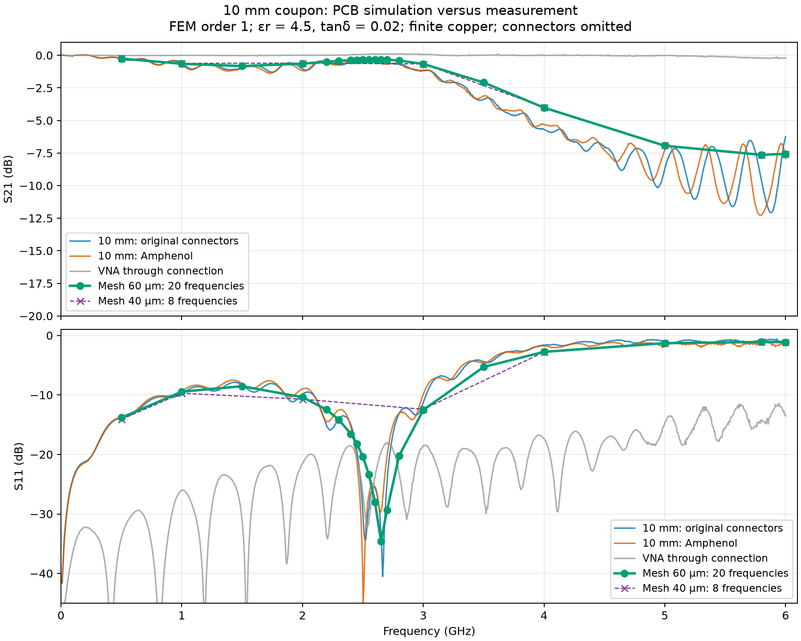
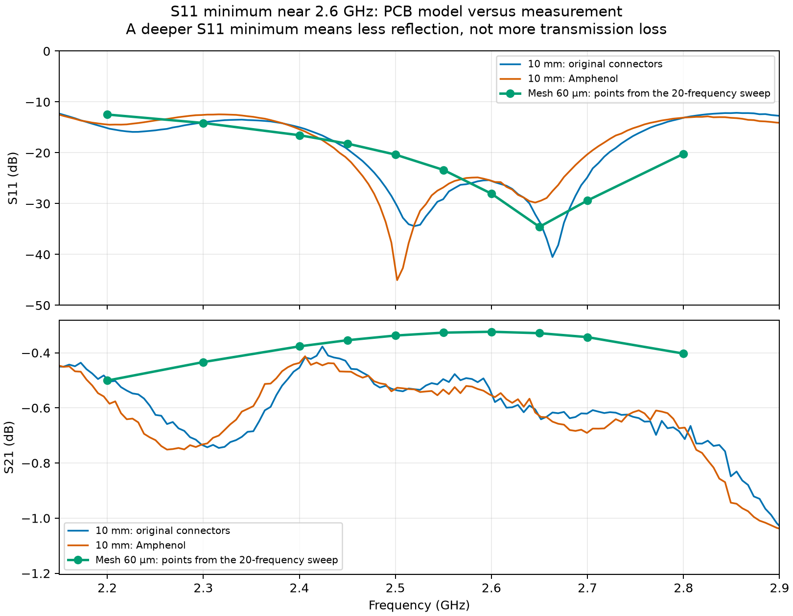

# 10 mm coupon: top/L2 simulation

## Which simulations produced these results?

**Two completed EM sweeps:** Mesh 40 µm at 8 frequencies, and Mesh 60 µm at 20 frequencies. That is 28 frequency cases in total. Each sweep computes the full two-port S-matrix. Two earlier second-order solve attempts were stopped for memory use and produced no completed S-parameter dataset. CAD exports, mesh generation and viewer previews are not additional EM sweeps.

**Mesh names refer to the requested signal-edge refinement size.** Neither mesh is uniform: the substrate, copper surfaces and ports have separate size targets.

| Parameter | Mesh 40 µm — 8 frequencies | Mesh 60 µm — 20 frequencies |
|---|---:|---:|
| Signal-edge target, µm | 40 | 60 |
| Signal-surface target, µm | 120 | 180 |
| Signal-surface growth cap, µm | 800 | 1200 |
| Port-face target, µm | 55 | 80 |
| Substrate target, µm | 550 | 900 |
| Mesh nodes | 71,060 | 37,185 |
| Tetrahedra | 419,408 | 218,732 |
| FEM element order | 1 | 1 |

Both sweeps use the same PCB geometry, materials, air box and ideal 50 Ω ports. Size targets are mesher inputs, not measured lengths of every tetrahedron. Mesh 40 µm samples 0.5, 1, 2, 3, 4, 5, 5.8 and 6 GHz. Mesh 60 µm includes these eight points and adds twelve, mainly around 2.6 GHz.

## Plots and their data

**Figure 1 — full band:** green circles are Mesh 60 µm (20 frequencies); purple dashed crosses are Mesh 40 µm (8 frequencies). Blue/orange/grey curves are measurements. The purple line skips directly from 2 to 3 GHz because that sweep did not sample the notch.

**Figure 2 — 2.6 GHz detail:** the green curve uses only Mesh 60 µm, showing its directly solved points in this window. There is no third mesh. The archived first comparison plot uses Mesh 40 µm only.

## Mesh 60 µm numerical results

Pure PCB model: original pads and tapers, ideal 50 Ω lumped ports; no SMA bodies, pins or solder.

FEM order: **1**. Mesh: 218,732 tetrahedra. FR-4 εr=4.5, tanδ=0.02; copper conductivity 58 MS/m.

**Both sweeps completed successfully.** The two meshes agree closely at eight shared frequencies (maximum change: 0.04 dB in S21 and 0.34 dB in S11). The 2.65 GHz notch has not yet been checked with Mesh 40 µm, and the effect of air-box size has not been checked with a larger box. These are checks of numerical accuracy; they do not mean that the equation solver failed.

| GHz | Simulated S11, dB | Simulated S21, dB | Measured original 10 mm S21, dB |
|---:|---:|---:|---:|
| 0.5 | -13.83 | -0.25 | -0.25 |
| 1 | -9.45 | -0.65 | -0.60 |
| 1.5 | -8.54 | -0.83 | -0.98 |
| 2 | -10.38 | -0.64 | -1.04 |
| 2.2 | -12.48 | -0.50 | -0.50 |
| 2.3 | -14.15 | -0.43 | -0.74 |
| 2.4 | -16.55 | -0.38 | -0.45 |
| 2.45 | -18.20 | -0.35 | -0.44 |
| 2.5 | -20.36 | -0.34 | -0.53 |
| 2.55 | -23.38 | -0.33 | -0.50 |
| 2.6 | -28.04 | -0.32 | -0.55 |
| 2.65 | -34.57 | -0.33 | -0.63 |
| 2.7 | -29.39 | -0.34 | -0.62 |
| 2.8 | -20.21 | -0.40 | -0.71 |
| 3 | -12.54 | -0.66 | -1.15 |
| 3.5 | -5.30 | -2.09 | -3.37 |
| 4 | -2.76 | -4.02 | -5.68 |
| 5 | -1.29 | -6.94 | -8.70 |
| 5.8 | -1.10 | -7.64 | -9.59 |
| 6 | -1.13 | -7.57 | -6.25 |

## The 2.6 GHz feature

The lowest sampled S11 in this window is **-34.57 dB at 2.65 GHz**, with S21=-0.33 dB. The model therefore reproduces a good-matching window near the measured notch. A dip in S11 means less reflection; it is not a dip in transmitted power. The measured split notch is not reproduced by these sampled model results. 50 MHz sampling identifies the region, not the exact continuous-frequency minimum.

## Mesh 40 µm versus Mesh 60 µm

At the eight common frequencies, the largest S21 change is **0.039 dB**, and the largest S11 change is **0.343 dB**. Both runs use first-order elements and identical geometry/materials. This checks the broad response; Mesh 40 µm did not sample the notch, so the notch depth and position have not been checked with Mesh 40 µm.

Observed private memory during a solve: approximately **5.7 GB** (one sample, not a peak measurement).

Elapsed time in the EMerge log: **166 s**, including meshing and 20 frequencies.

Measured values in this table are interpolated in dB to the directly solved frequencies. Plot markers are solved points; connecting lines do not resolve resonances between them.

## Interpretation

At 5.8 GHz the simulated incident power divides into **77.6% reflected**, **17.2% transmitted**, and **5.2% dissipated or radiated**. Most of the transmission reduction in this model is therefore mismatch.

The pure PCB reproduces a substantial high-frequency transmission drop and strong reflection with the specified εr=4.5 and tanδ=0.02. This supports PCB pad/transition mismatch as a major contributor; these measurements alone do not establish unusually high substrate loss. A uniform-line control simulation is still needed to isolate the pads from the rest of the PCB.

The current frequency sampling does not resolve or explain the measured high-frequency ripples. Ideal port location/profile, omitted connector pins and solder, measurement residuals, and numerical approximation limit a quantitative comparison. Agreement with measurements supports the broad trend, but does not replace checking sensitivity to mesh refinement and air-box size.

Maximum complex reciprocity error |S21−S12|: 2.4e-06. Maximum scattering-matrix singular value: 0.995863 (a passive model should be ≤1, within numerical error).

## Data locations

- **Mesh 60 µm, 20 frequencies:** `result_2layer.npz`, `result_2layer.json`, `result_2layer.s2p`; plots and metrics in `preview_2layer/`.
- **Mesh 40 µm, 8 frequencies:** `runs/baseline_8pt/`; this contains the archived first full-band plot and its original data.
- `preview/` is an earlier four-layer geometry/mesh preview. No EM sweep was completed with it; it supplies none of the curves in this report.
