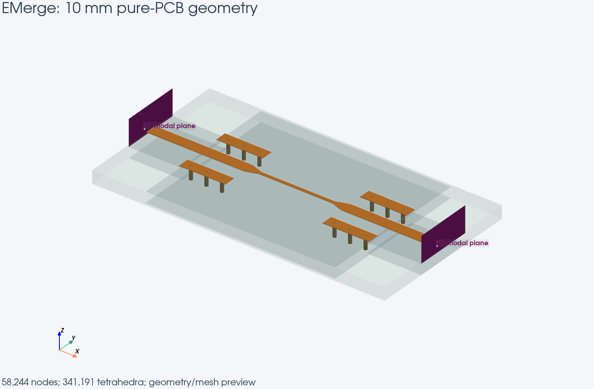
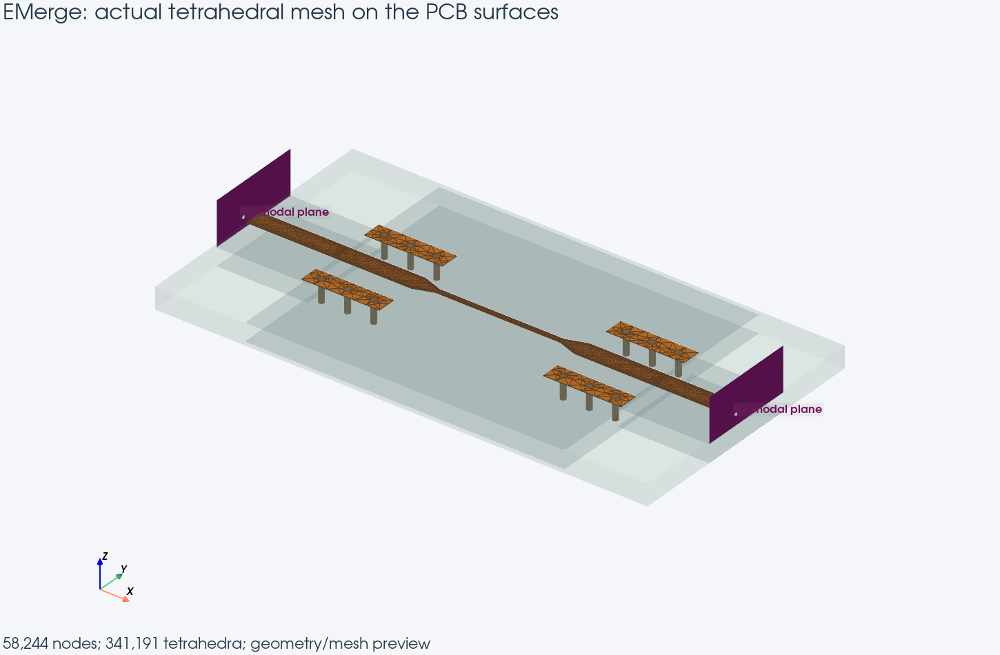
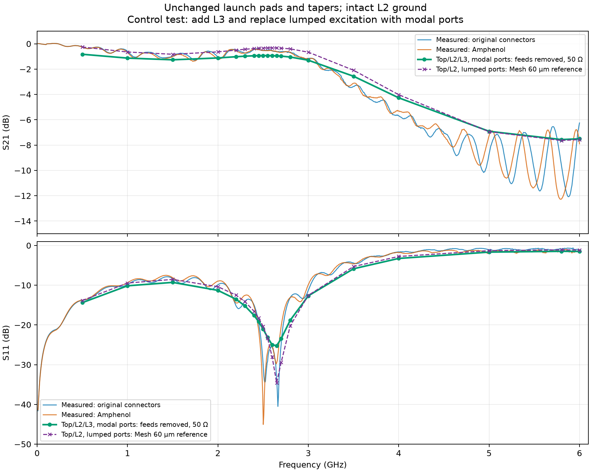

# Modal-port control: unchanged launches

**L2 is intact. The two signal pads and their tapers have not been redesigned.** This test adds L3 and changes the excitation before investigating ground openings.

## Outcome

**Broad agreement, but the modal fixture is not yet verified as an equivalent replacement.** It reproduces the high-frequency roll-off and the low-reflection window near 2.6 GHz. However, below 3.5 GHz it adds approximately 0.4–0.65 dB of transmission reduction compared with the lumped reference. The sampled S11 notch is also shallower. At 0.5 GHz, the unprocessed native modal result already has |S11|²+|S21|²=0.882; the additional power deficit therefore exists before converting to 50 Ω or removing the feeds. It must not be attributed to PCB material loss without a control test.

The feed-removal and impedance-conversion operations were checked by reversing them (round-trip errors below 1e-14). Passivity and reciprocity checks pass, but these checks do not explain the extra attenuation. The next check should be a uniform through line using the same stack, feed cross-section and modal ports, compared with its propagation constant. Do that before using this fixture to select an L2 opening.

## Test configuration

| Parameter | Lumped reference | Modal control |
|---|---|---|
| Copper layers | Top, L2 | Top, L2, L3 |
| Excitation | Internal 50 Ω sheets | Quasi-TEM modes on outer feed planes |
| Tetrahedra | 218,732 | 341,191 |
| Signal-edge target | 60 µm | 60 µm |
| Port-face target | 80 µm | 250 µm |
| FEM order / frequencies | 1 / 20 | 1 / 20 |
| Reference planes | x=0.40, 19.76 mm | x=0.28, 19.88 mm after feed removal |

The artificial access lines are 1.2 mm wide, matching the pads. Their native impedance is approximately 23 Ω, not 50 Ω. Uniform dielectric and ground extensions place the modal planes away from the launch. They are a test fixture, not a model of the SMA connector.

## Comparing reference planes

First remove each 5.28 mm feed in its native modal reference, using the solved complex propagation constant. Then convert the S-matrix to a common 50 Ω reference. With EMerge’s exp(−jβx) convention:

$$
S_{ij}^{\mathrm{pad}}=S_{ij}^{\mathrm{feed}}\exp[j(\beta_i l_i+\beta_j l_j)].
$$

The propagation constant includes the dielectric attenuation found by the mode solver; a separate calibration of residual finite-copper feed loss has not been performed. The reference planes differ from the old internal lumped sheets by 0.12 mm at each end. Adding L3 and changing the port fixture are both part of this test, so it is not an isolated test of only one of these changes.

| GHz | Modal/L3 S11, dB | Lumped/L2 S11, dB | Modal/L3 S21, dB | Lumped/L2 S21, dB |
|---:|---:|---:|---:|---:|
| 0.5 | -14.38 | -13.83 | -0.83 | -0.25 |
| 1 | -10.14 | -9.45 | -1.13 | -0.65 |
| 1.5 | -9.28 | -8.54 | -1.26 | -0.83 |
| 2 | -11.30 | -10.38 | -1.12 | -0.64 |
| 2.2 | -13.51 | -12.48 | -1.02 | -0.50 |
| 2.3 | -15.22 | -14.15 | -0.98 | -0.43 |
| 2.4 | -17.61 | -16.55 | -0.95 | -0.38 |
| 2.45 | -19.16 | -18.20 | -0.94 | -0.35 |
| 2.5 | -21.02 | -20.36 | -0.93 | -0.34 |
| 2.55 | -23.14 | -23.38 | -0.93 | -0.33 |
| 2.6 | -25.00 | -28.04 | -0.94 | -0.32 |
| 2.65 | -25.22 | -34.57 | -0.95 | -0.33 |
| 2.7 | -23.43 | -29.39 | -0.98 | -0.34 |
| 2.8 | -18.82 | -20.21 | -1.05 | -0.40 |
| 3 | -12.67 | -12.54 | -1.30 | -0.66 |
| 3.5 | -5.86 | -5.30 | -2.56 | -2.09 |
| 4 | -3.26 | -2.76 | -4.27 | -4.02 |
| 5 | -1.66 | -1.29 | -6.91 | -6.94 |
| 5.8 | -1.46 | -1.10 | -7.56 | -7.64 |
| 6 | -1.49 | -1.13 | -7.50 | -7.57 |

## Numerical checks

Modal Z0 range: 22.78–22.93 Ω. Maximum |S21−S12|: 5.1e-08. Maximum singular value after feed removal and conversion to 50 Ω: 0.970671.

Raw native S, feed-plane S at 50 Ω, pad-plane S at 50 Ω, Z0 and β are preserved in `result_3layer_modal.npz`. The two exported Touchstone files explicitly name their reference planes.
