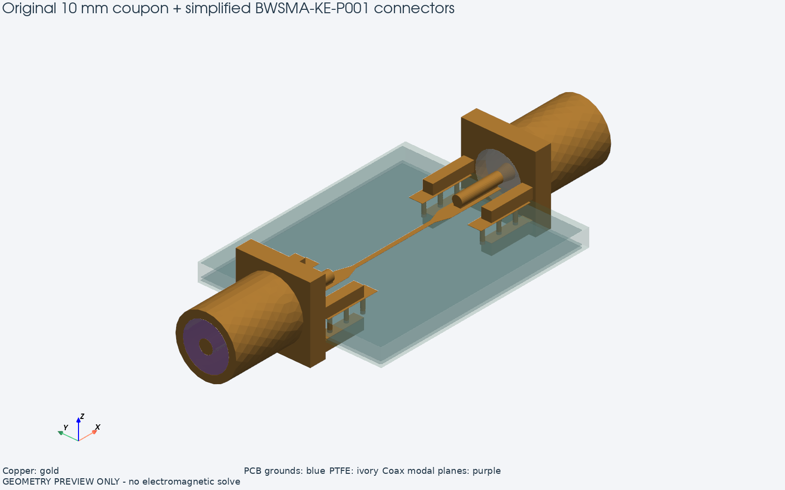
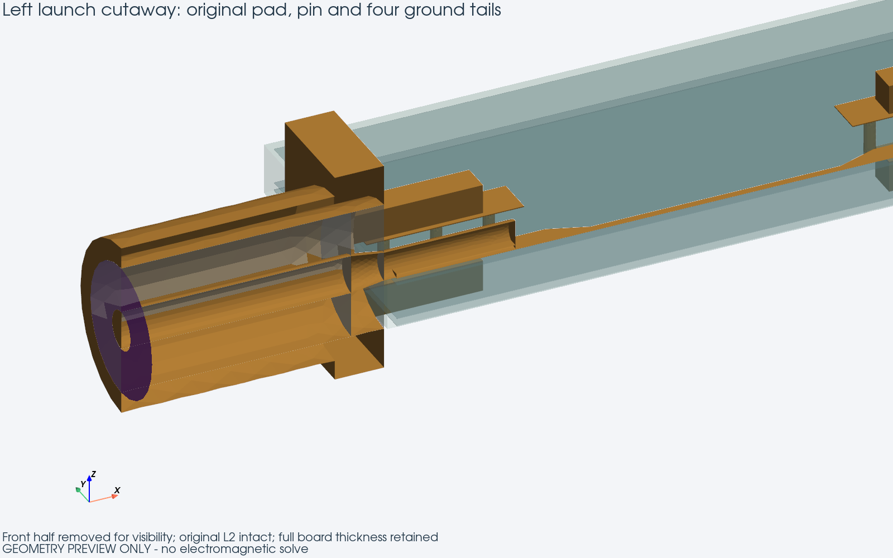
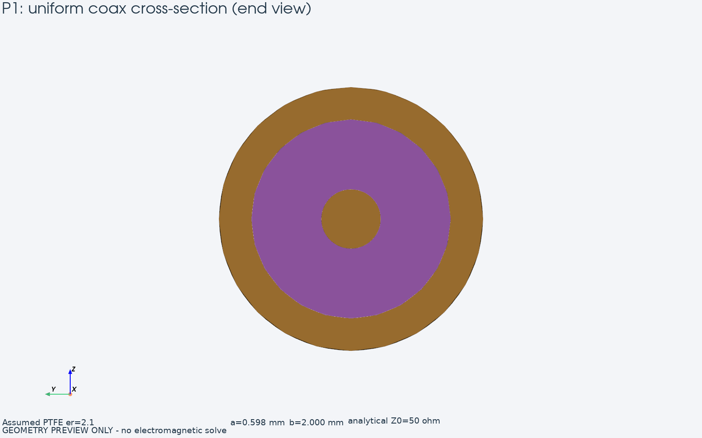
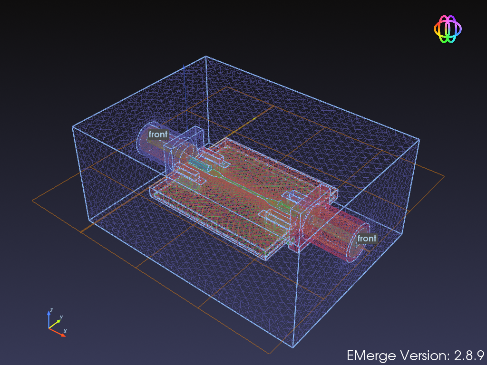

# Original BWSMA-KE-P001: connector geometry proposal

**Status: geometry approved; the first 20-point sweep of this unchanged model
is complete. See [results and measurement comparison](04_COAX_RESULTS.md).**
The illustrations below were made before the solve; their preview labels
describe the rendering stage.

The unchanged 10 mm coupon now connects to two simplified BWSMA-KE-P001
connectors. The excitation planes are annuli inside their uniform coax sections.
There are no artificial microstrip extensions and no L2 opening in this control.

## Mechanics and placement

Dimensions come from the [manufacturer's mechanical drawing](https://www.es.co.th/Schemetic/PDF/BWSMA-KE-P001_EN.PDF)
and the repository's `SMA_BWSMA-KE-P001_EdgeMount.step`. The STEP is useful for
external mechanics; it does not provide a complete separated RF interior.

| Feature | Model value | Basis |
|---|---:|---|
| Flange cross-section | 6.5 × 6.5 mm | Drawing / STEP |
| Flange axial length | 1.5 mm | 9.5 mm body minus 8 mm barrel in drawing |
| Smooth barrel diameter | 5.3 mm | Drawing; threads omitted |
| Signal tail diameter / length | 0.9 / 4 mm | Drawing / STEP |
| Four ground tails | 0.9 × 0.9 mm, 4 mm long | Drawing / STEP |
| Ground tail centres in y | ±2.55 mm | Drawing / PCB pad positions |
| Upper / lower tail centre separation | 2.5 mm | 1.6 mm board gap + 0.9 mm tail width |
| Connector rear face to board edge | 0.10 mm | Placement assumption |
| Signal axis above top copper bottom | 0.485 mm | 0.035 mm copper + 0.45 mm pin radius |
| Included uniform coax and rear transition | 8 mm per connector | Truncated before mating socket |

The original PCB stack is restored: F.Cu, L2, L3 and B.Cu, including the
12 ground via barrels. The physical board is 20.16 × 16 × 1.5862 mm. Its
lower connector tails connect to the bottom ground pads; truncating the board
at L3 would give these contacts the wrong geometry. L2 remains intact beneath
both signal pads.

Small solid contact bridges connect the round signal pin and ground tails to
the pads. These avoid electrically ambiguous tangent-only contacts. They are
ideal contact approximations, not reconstructions of measured solder fillets.
The drawing's 1.6 mm board gap leaves a 13.8 µm clearance for the nominal
1.5862 mm board; the lower bridges fill this clearance.

## Coax interior and modal planes

The internal RF dimensions are **assumed**, rather than extracted from the
external STEP. The uniform section has PTFE with relative permittivity 2.1,
outer-conductor inner radius b=2 mm, and centre-conductor radius

$$
a=b\exp\left(-\frac{50\sqrt{\epsilon_r}}{60}\right)
 =0.598\ \mathrm{mm},\qquad
Z_0\simeq\frac{60}{\sqrt{\epsilon_r}}\ln\frac ba=50\ \Omega.
$$

A 1 mm conical transition reduces this conductor to the drawing's 0.45 mm
tail radius at the rear face. The matching sockets, threads and cable plugs
are omitted. Thus this is a simplified launch fixture, not a manufacturer
connector model with verified S-parameters.

P1 and P2 lie at x=−8.10 and 28.26 mm. The homogeneous PTFE annuli use
`ModalPort(..., modetype='TEM', mixed_materials=False)`, with radial voltage
integration lines from the centre conductor to the shield. The 50 Ω above is
an analytical design value. The completed sweep gives a numerical modal
impedance of approximately 49.254 Ω; plotted results use a common 50 Ω
reference. Both planes are the reference planes for connector-inclusive results.

The surrounding air box spans x=−8.10…28.26, y=−13…13 and z=−7…9 mm,
with a first-order absorbing outer boundary. It is not a metal enclosure.
FR4 uses εr=4.5 and tanδ=0.02; all metal uses copper conductivity
5.8×10⁷ S/m. Connector plating and solder mask are omitted.

## Review and checks

CAD checks find exactly two continuous metal networks: signal and ground.
They are separate; both port areas equal the analytical annulus area,
11.443605 mm². These checks establish geometry connectivity, not RF accuracy.

The PNGs tessellate the actual committed OCC surfaces for illustration. Their
visible facets are not the simulation mesh. `--view` uses EMerge's coarse
preview mesh; `--view-mesh` generates the actual FEM mesh with these targets:

| Region | Size target |
|---|---:|
| PCB dielectric | 0.90 mm |
| Signal surface | 0.18 mm |
| Signal edges | 0.06 mm |
| Connector surfaces | 0.45 mm |
| Coax port faces | 0.22 mm |

The generated FEM mesh has **63,157 nodes and 370,867 tetrahedra**. Meshing
and internal mesh-data preparation took approximately 98 seconds on this PC.
Use `--reuse-mesh --view-mesh` to inspect it without regenerating it. The
loader checks PCB source hash, connector parameters, layer list, port locations
and mesh settings against `preview_coax/mesh.json`.

Commands, illustration generation and the viewer fix are documented in
[README](index.md). Results are documented separately in [COAX_RESULTS](04_COAX_RESULTS.md).
