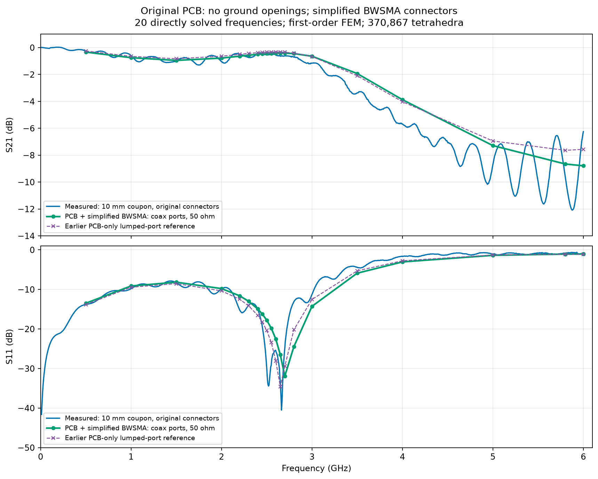
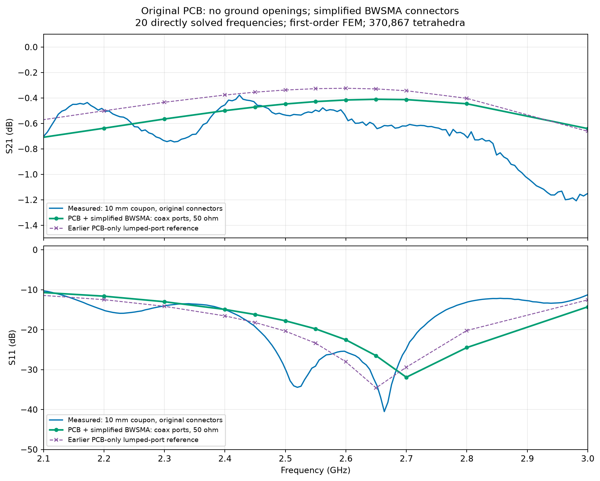
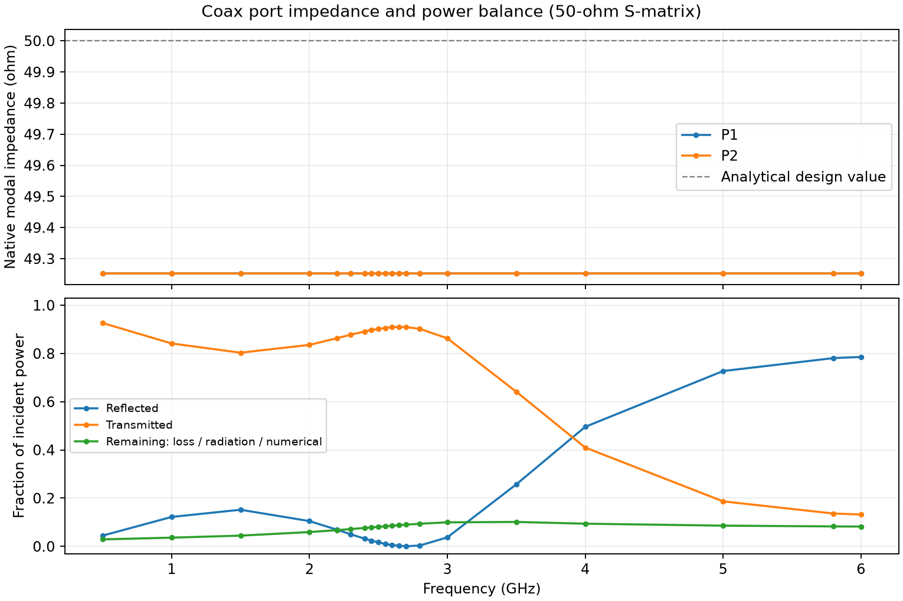

# Original PCB with simplified BWSMA connectors: first control

**One new completed sweep: 20 frequencies, original ground beneath both launch pads.** No ground openings, mesh variants or geometry optimization are included in this result.



The connector-inclusive model reproduces the broad response: low transmission loss below about 3 GHz, a reflection minimum around 2.7 GHz, and strong reflection / transmission reduction above 3 GHz. It does not reproduce the measured high-frequency ripples or both narrow measured reflection minima near 2.5–2.7 GHz. At 3.5–5 GHz it predicts roughly 1.4–1.8 dB more transmission than measured. Adding these connectors therefore preserves the main earlier diagnosis, but does not produce a substantially better overall measurement fit.

## Configuration

The approved [connector geometry](03_CONNECTOR_GEOMETRY.md) is unchanged. The model retains all four copper layers, 12 ground vias, original pads and tapers, and simplified connector signal pins, ground tails, shields and PTFE. First-order FEM uses 370,867 tetrahedra / 63,157 nodes. One EMerge `run_sweep()` solves 20 frequencies from 0.5 to 6 GHz; `frequency_groups=1` limits matrix memory. The solve took 3.1 minutes.

The reference planes are coax annuli at x=−8.10 and 28.26 mm. The connectors remain included: no connector or feed de-embedding is applied. The raw native S-matrix, modal impedances and propagation constants are preserved; the plotted matrix and Touchstone export use a common 50 Ω reference. The measured file is `coupon_7628_horizontal_10mm.s2p`; its S12/S22 zero placeholders are not used. The Amphenol measurement is not the target of this control.

## Numerical comparison

Mean absolute S21 difference across the 20 sampled frequencies: **0.53 dB**. The earlier PCB-only lumped model gives 0.55 dB on the same frequencies. These are descriptive fit statistics, not estimated measurement or simulation uncertainties. Measurement amplitudes in dB are linearly interpolated onto the simulation frequencies for the table and this statistic.

| GHz | Sim. S21, dB | Meas. S21, dB | Sim. S11, dB | Meas. S11, dB |
|---:|---:|---:|---:|---:|
| 0.5 | -0.33 | -0.25 | -13.50 | -13.80 |
| 1 | -0.75 | -0.60 | -9.13 | -9.81 |
| 1.5 | -0.95 | -0.98 | -8.18 | -8.32 |
| 2 | -0.78 | -1.04 | -9.79 | -9.89 |
| 2.2 | -0.64 | -0.50 | -11.61 | -15.15 |
| 2.3 | -0.57 | -0.74 | -13.00 | -14.05 |
| 2.4 | -0.50 | -0.45 | -14.93 | -14.99 |
| 2.45 | -0.47 | -0.44 | -16.20 | -19.28 |
| 2.5 | -0.45 | -0.53 | -17.77 | -29.89 |
| 2.55 | -0.43 | -0.50 | -19.80 | -29.08 |
| 2.6 | -0.42 | -0.55 | -22.53 | -25.55 |
| 2.65 | -0.41 | -0.63 | -26.52 | -33.52 |
| 2.7 | -0.41 | -0.62 | -31.91 | -24.78 |
| 2.8 | -0.45 | -0.71 | -24.48 | -13.12 |
| 3 | -0.64 | -1.15 | -14.28 | -11.27 |
| 3.5 | -1.93 | -3.37 | -5.90 | -4.41 |
| 4 | -3.87 | -5.68 | -3.05 | -1.61 |
| 5 | -7.29 | -8.70 | -1.38 | -1.05 |
| 5.8 | -8.65 | -9.59 | -1.07 | -0.86 |
| 6 | -8.79 | -6.25 | -1.05 | -1.10 |



Markers are directly solved points; connecting segments are only a visual guide. The lowest sampled simulated S11 occurs at 2.7 GHz. This is not a continuous-frequency search for the exact notch.

## Port and consistency checks



Native modal Z0 spans 49.253–49.254 Ω; maximum imaginary part magnitude 0 Ω. Maximum |S21−S12|: 3.6e-12; maximum |S11−S22|: 0.00222; maximum singular value: 0.994294.

The remaining power fraction combines dielectric/conductor dissipation, radiation and numerical error; it is not an isolated estimate of FR4 loss. Reciprocity, symmetry and passivity checks do not establish mesh or air-box convergence. This is a first connector-inclusive control on one mesh, with the documented internal connector and solder-contact approximations.

EMerge emitted overlap-priority warnings where PCB copper, via barrels, connector tails and ideal contact bridges overlap. Every listed contender in those warnings uses the same Copper material instance; these overlaps do not request conflicting dielectric/conductor properties. The CAD connectivity checks still find exactly one signal network and one separate ground network.

## Files and reproduction

- `result_coax_intact.npz`: raw/native and 50 Ω S, modal Z0 and β.
- `result_coax_intact.json`: geometry, mesh and completed-sweep metadata.
- `result_coax_intact.s2p`: connector-inclusive 50 Ω S-parameters.
- `preview_coax/comparison_metrics.json`: all sampled comparison values and checks.

From `C:\Fun\ToyRadar\Frontend\emerge`:

```powershell
.\.venv\Scripts\python.exe -m coupon_10mm.connector_model --reuse-mesh --solve
.\.venv\Scripts\python.exe -m coupon_10mm.compare_coax
```
