# L2 cutouts beneath the launch pads: first trial

**One new completed sweep: two 1.6 × 4.8 mm L2 cutouts, 20 frequencies.** Compared below with the completed original-ground connector control; no parameter search or extra mesh variant.

**The cutouts substantially improve broadband transmission in this model.** At 4 GHz, S21 changes from -3.87 to -0.42 dB. At 6 GHz, it changes from -8.79 to -1.32 dB (7.47 dB improvement), while S11 improves from -1.05 to -8.48 dB. The former high-frequency mismatch is greatly reduced; this supports the pad-capacitance diagnosis. The initial cutout size is promising but still leaves appreciable reflection at the upper end of the band.

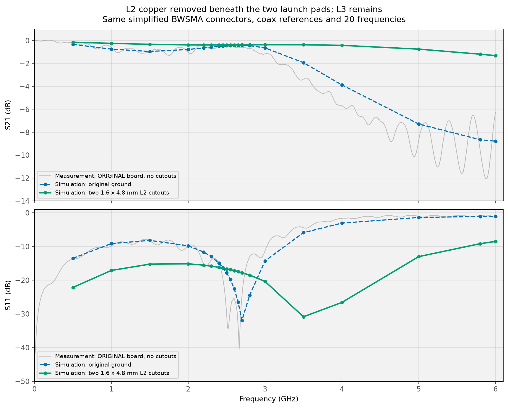

## Exactly what changed

Only L2 copper is removed: left x=0.28…5.08 mm, right x=15.08…19.88 mm, y=±0.8 mm. The dielectric remains. L3 and bottom copper, ground tabs, vias, signal pads, tapers and both connectors are unchanged. The cutouts stop at the inner edges of the wide signal pads, before the tapers. These are copper keepouts, not milled board slots.

The hypothesis is that removing the nearest ground reduces the wide pad’s excess capacitance. The next continuous plane beneath the pad is now L3, approximately 1.29 mm below the top surface instead of L2 at 0.2104 mm. Fringing fields still reach the nearby L2 edges, and the return-current path also changes; this is not equivalent to changing only a lumped capacitor.

The occupancy checks confirm empty L2 at both cutout centres; L3 remains beneath them, and L2 remains beneath the tapers and ground contacts and beside the windows. The CAD still has one continuous signal network and one separate ground network.

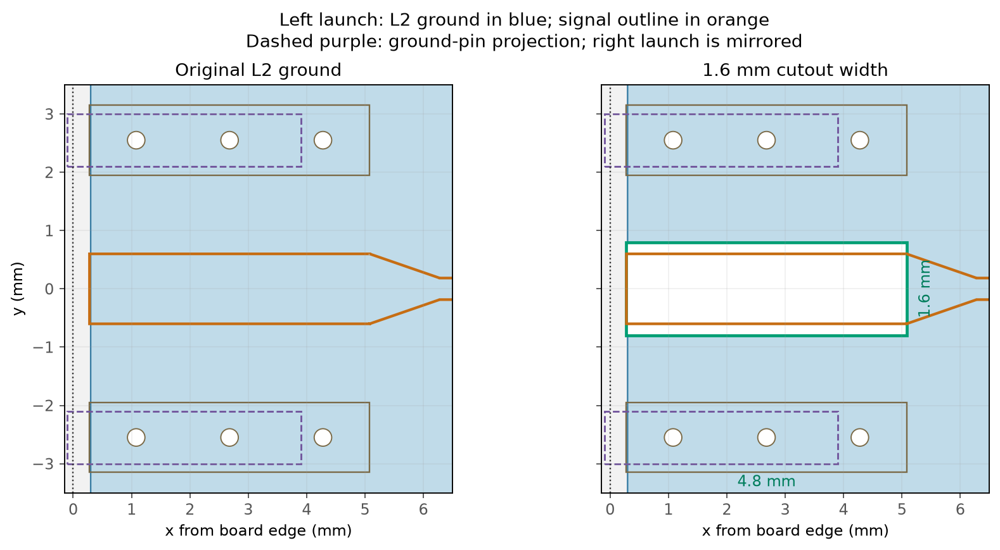

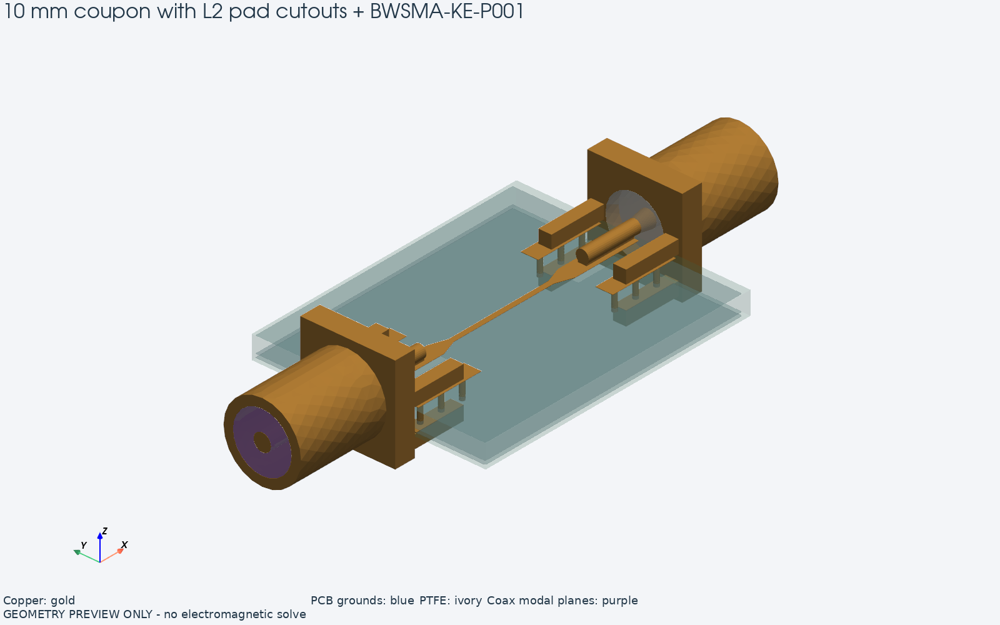

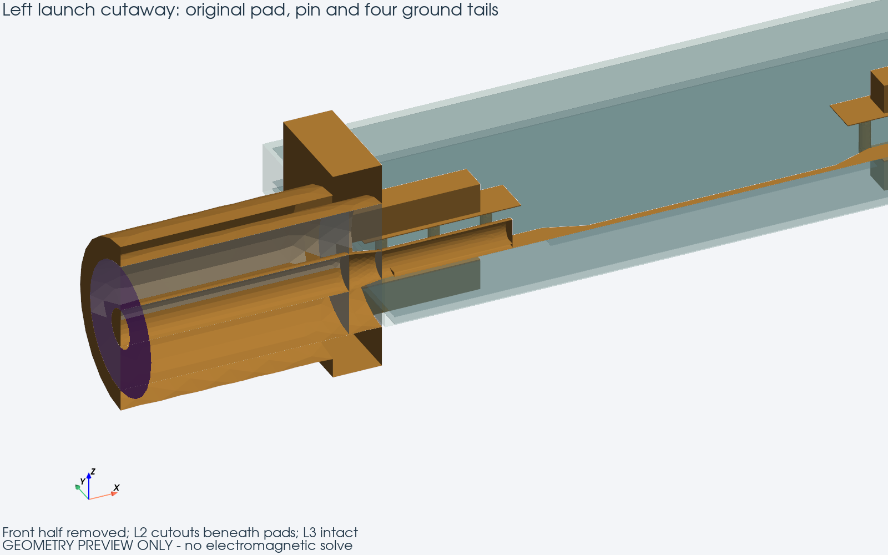

## Controlled comparison

| Parameter | Original ground | L2 cutouts |
|---|---:|---:|
| Tetrahedra | 370,867 | 366,264 |
| Nodes | 63,157 | 62,361 |
| Signal-edge / signal-surface target | 0.06 / 0.18 mm | same |
| Substrate / connector / port target | 0.90 / 0.45 / 0.22 mm | same |
| FEM order / direct frequencies | 1 / 20 | same |
| Connector, material and air-box parameters | baseline | unchanged |

Both curves include the connectors at coax reference planes x=−8.10 and 28.26 mm and use a common 50 Ω reference. New meshing is necessary because the geometry changed; the element count need not remain identical. The new frequency sweep took 3.7 minutes.

**The grey measurement is the original unmodified board.** There is no measured cutout board yet, so it is shown for context, not as a fit target for the redesign.

| GHz | Original S21, dB | Cutout S21, dB | Improvement, dB | Original S11, dB | Cutout S11, dB |
|---:|---:|---:|---:|---:|---:|
| 0.5 | -0.33 | -0.15 | +0.19 | -13.50 | -22.15 |
| 1 | -0.75 | -0.24 | +0.50 | -9.13 | -17.11 |
| 1.5 | -0.95 | -0.33 | +0.62 | -8.18 | -15.23 |
| 2 | -0.78 | -0.38 | +0.40 | -9.79 | -15.13 |
| 2.2 | -0.64 | -0.38 | +0.26 | -11.61 | -15.53 |
| 2.3 | -0.57 | -0.38 | +0.18 | -13.00 | -15.82 |
| 2.4 | -0.50 | -0.38 | +0.12 | -14.93 | -16.18 |
| 2.45 | -0.47 | -0.38 | +0.09 | -16.20 | -16.39 |
| 2.5 | -0.45 | -0.38 | +0.07 | -17.77 | -16.62 |
| 2.55 | -0.43 | -0.38 | +0.05 | -19.80 | -16.87 |
| 2.6 | -0.42 | -0.38 | +0.04 | -22.53 | -17.14 |
| 2.65 | -0.41 | -0.37 | +0.04 | -26.52 | -17.44 |
| 2.7 | -0.41 | -0.37 | +0.04 | -31.91 | -17.76 |
| 2.8 | -0.45 | -0.37 | +0.08 | -24.48 | -18.49 |
| 3 | -0.64 | -0.36 | +0.28 | -14.28 | -20.35 |
| 3.5 | -1.93 | -0.37 | +1.56 | -5.90 | -30.85 |
| 4 | -3.87 | -0.42 | +3.45 | -3.05 | -26.60 |
| 5 | -7.29 | -0.75 | +6.54 | -1.38 | -13.00 |
| 5.8 | -8.65 | -1.19 | +7.46 | -1.07 | -9.15 |
| 6 | -8.79 | -1.32 | +7.47 | -1.05 | -8.48 |

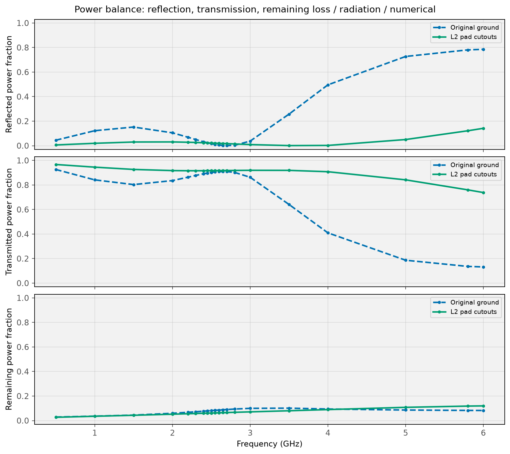

“Remaining” power includes dissipation, radiation and numerical error; it is not a separate measurement of dielectric loss. Positive S21 improvement means increased transmission relative to the original-ground simulation at that frequency.

At 6 GHz with cutouts: 73.8% transmitted, 14.2% reflected, 12.0% remaining. The dominant benefit is reduced reflection rather than a claim that the substrate has become less lossy.

## Numerical checks and limits

Native modal impedance: 49.253–49.254 Ω. Maximum |S21−S12|: 1.79e-12; maximum |S11−S22|: 0.00189; maximum singular value: 0.993963.

This is one initial cutout size on one first-order mesh, not an optimized design or a convergence study. Connector interior and ideal solder-contact assumptions are the same as in [the geometry report](03_CONNECTOR_GEOMETRY.md).

## Reproduce

From `C:\Fun\ToyRadar\Frontend\emerge`:

```powershell
.\.venv\Scripts\python.exe -m coupon_10mm.connector_model --l2-opening 1.6 4.8 --reuse-mesh --view-mesh
.\.venv\Scripts\python.exe -m coupon_10mm.connector_model --l2-opening 1.6 4.8 --reuse-mesh --solve
.\.venv\Scripts\python.exe -m coupon_10mm.compare_cutout --l2-opening 1.6 4.8
```

Raw/native and 50 Ω S, Z0 and β: `result_coax_open_1.6x4.8mm.npz`; solve metadata: `result_coax_open_1.6x4.8mm.json`; 50 Ω Touchstone: `result_coax_open_1.6x4.8mm.s2p`. The original control files remain separate.

<!-- L2-WIDTH-COMPARISON -->

## Wider cutout: up to the ground pins

**Second cutout trial completed: two 4.2 × 4.8 mm openings, 20 frequencies.** The intact-ground control and first 1.6 mm trial above are preserved. This width comparison uses three completed connector sweeps: original ground, narrow cutouts and wide cutouts.

At 4 GHz, widening changes S21 from **-0.42 to -1.18 dB**. At 6 GHz, S21 changes from **-1.32 to -0.76 dB**, and S11 from **-8.48 to -14.53 dB**. The worst sampled S21 of the wider variant over 0.5–6 GHz is -1.18 dB; its worst sampled S11 is -8.96 dB.

**Wider is a tradeoff, not a uniform improvement.** The 4.2 mm window improves low-frequency matching and the response at 5.8–6 GHz, but introduces a broad transmission reduction around the sampled 4 GHz point, where reflection also increases. The 1.6 mm window performs better through roughly 3–5 GHz. Neither width dominates the other across the full band; maximum width alone is therefore not an optimization rule. An intermediate width or a shaped window would be a reasonable next trial. The present 4–5 GHz sampling does not locate the exact frequency or depth of the wider window’s worst response.

Ground-pin centres are at y=±2.55 mm and the pins are 0.9 mm wide. Their inner edges are therefore y=±2.10 mm, so the maximum cutout width without going beneath the pins is **2×(2.55−0.45)=4.20 mm**. The length stays 4.8 mm; x limits remain 0.28…5.08 mm and 15.08…19.88 mm. Ground vias remain outside the windows.

The top ground pads extend inward to y=±1.95 mm. The wider window therefore removes L2 under their inner 0.15 mm overhang, but not under the metal pins or their ideal contact bridges. Top copper is unchanged. Occupancy checks explicitly confirm L2 beneath both pins at y=±2.11 mm, as well as L3 beneath the windows and L2 beneath the tapers.

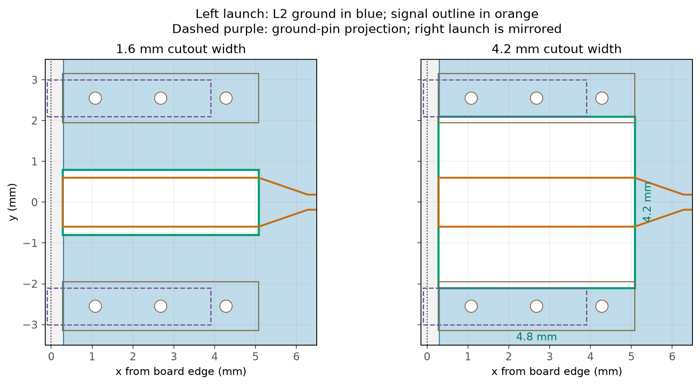

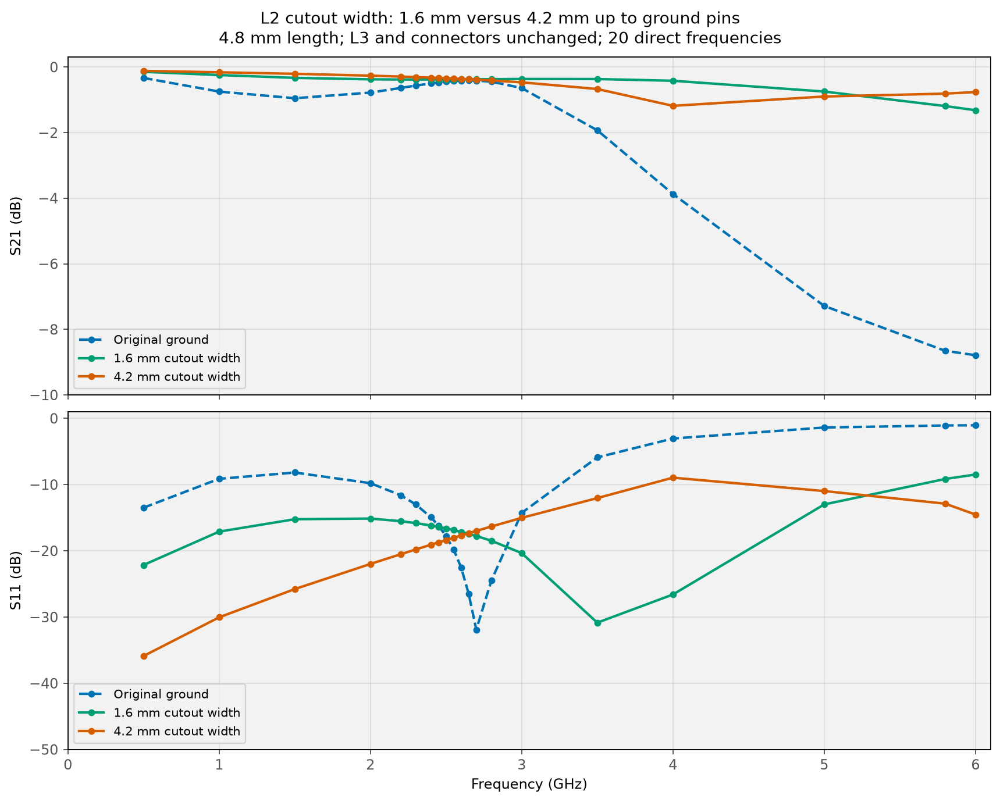

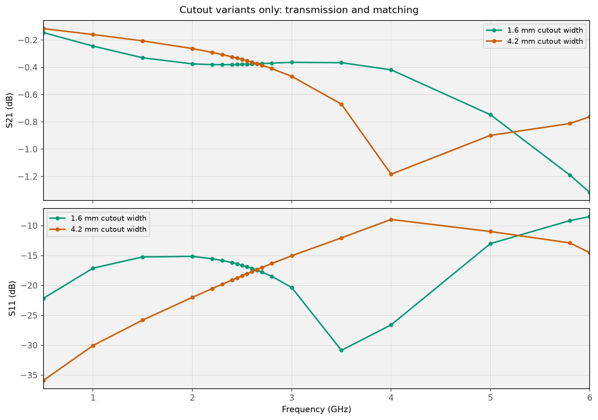

| GHz | 1.6 mm S21, dB | 4.2 mm S21, dB | Change, dB | 1.6 mm S11, dB | 4.2 mm S11, dB |
|---:|---:|---:|---:|---:|---:|
| 0.5 | -0.15 | -0.12 | +0.03 | -22.15 | -35.89 |
| 1 | -0.24 | -0.16 | +0.08 | -17.11 | -30.05 |
| 1.5 | -0.33 | -0.21 | +0.12 | -15.23 | -25.78 |
| 2 | -0.38 | -0.26 | +0.11 | -15.13 | -21.99 |
| 2.2 | -0.38 | -0.29 | +0.09 | -15.53 | -20.52 |
| 2.3 | -0.38 | -0.31 | +0.07 | -15.82 | -19.80 |
| 2.4 | -0.38 | -0.32 | +0.06 | -16.18 | -19.08 |
| 2.45 | -0.38 | -0.33 | +0.05 | -16.39 | -18.73 |
| 2.5 | -0.38 | -0.34 | +0.04 | -16.62 | -18.38 |
| 2.55 | -0.38 | -0.35 | +0.02 | -16.87 | -18.03 |
| 2.6 | -0.38 | -0.36 | +0.01 | -17.14 | -17.68 |
| 2.65 | -0.37 | -0.37 | +0.00 | -17.44 | -17.34 |
| 2.7 | -0.37 | -0.39 | -0.01 | -17.76 | -17.00 |
| 2.8 | -0.37 | -0.41 | -0.04 | -18.49 | -16.33 |
| 3 | -0.36 | -0.47 | -0.10 | -20.35 | -15.03 |
| 3.5 | -0.37 | -0.67 | -0.30 | -30.85 | -12.04 |
| 4 | -0.42 | -1.18 | -0.77 | -26.60 | -8.96 |
| 5 | -0.75 | -0.90 | -0.15 | -13.00 | -10.98 |
| 5.8 | -1.19 | -0.81 | +0.38 | -9.15 | -12.88 |
| 6 | -1.32 | -0.76 | +0.55 | -8.48 | -14.53 |

Positive S21 change means more transmission than the 1.6 mm cutout at that frequency. A more negative S11 indicates less reflection. The original-board measurement is not a measurement of either cutout design.

### Mesh and numerical checks

The wider geometry has 361,630 tetrahedra and 61,620 nodes. The sweep took 4.4 minutes. Mesh size targets, first-order basis, frequency grid, connector assumptions, materials, air box and coax reference planes match the preceding two sweeps. Only cutout width changed; the mesh was regenerated.

Native modal Z0: 49.253–49.254 Ω; maximum |S21−S12|: 1.33e-12; maximum |S11−S22|: 0.00345; maximum singular value: 0.994042. This is another geometry trial on one mesh, not a convergence result.

### Reproduce the wide variant

From `C:\Fun\ToyRadar\Frontend\emerge`:

```powershell
.\.venv\Scripts\python.exe -m coupon_10mm.connector_model --l2-opening 4.2 4.8 --reuse-mesh --view-mesh
.\.venv\Scripts\python.exe -m coupon_10mm.connector_model --l2-opening 4.2 4.8 --reuse-mesh --solve
.\.venv\Scripts\python.exe -m coupon_10mm.compare_cutout --compare-widths
```

Results: `result_coax_open_4.2x4.8mm.npz`, `result_coax_open_4.2x4.8mm.json` and `result_coax_open_4.2x4.8mm.s2p`. Geometry, mesh metadata and comparison plots: `preview_coax_open_4.2x4.8mm/`.

<!-- LAUNCH-STEP-COMPARISON -->

## Abrupt pad-to-microstrip steps with the 4.2 mm cutouts

**Fourth completed connector sweep: abrupt transitions, same 20 frequencies over 0.5–6 GHz.** It is compared with the existing 4.2 mm cutout / tapered-transition sweep. No previous result was overwritten; no additional target-band frequency sweep was run.

At **5.8 GHz**, S21 changes from **-0.81 to -1.11 dB**, and S11 changes from **-12.88 to -9.34 dB**.

| At 5.8 GHz | Original tapers | Abrupt steps |
|---|---:|---:|
| S21, dB | -0.81 | -1.11 |
| S11, dB | -12.88 | -9.34 |

**For the sampled 5.8 GHz point, retain the tapered design as the reference.** The abrupt steps cost approximately 0.30 dB of transmission and increase reflection there. They improve matching at lower frequencies and slightly improve transmission through roughly 2–4 GHz, but that benefit is outside the application band. This comparison supports keeping the original tapers while investigating other options for the 5.8 GHz launch.

The application band is **5.725–5.875 GHz**. Of the retained broad-band grid, only 5.8 GHz lies inside it. The shading marks the requested band; line segments through it are visual guides, not additional solved points or a band-edge guarantee.

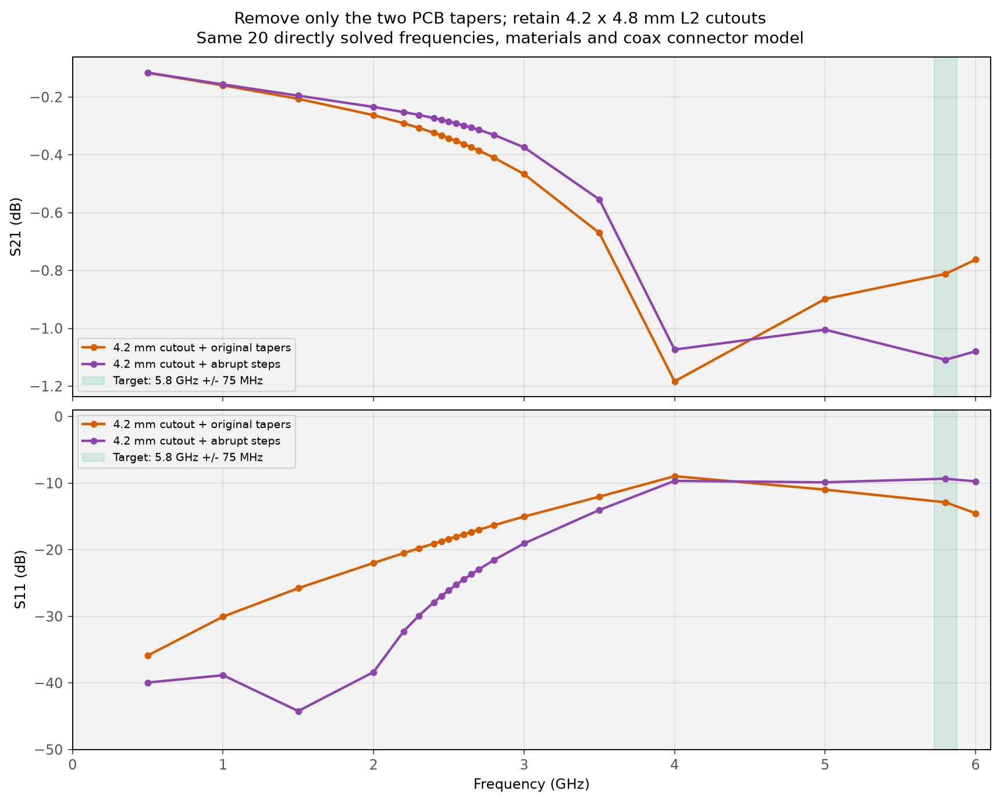

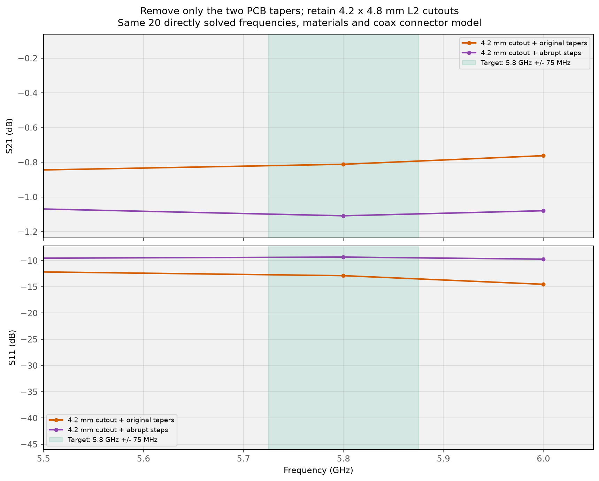

### Geometry change

Each top signal pad remains 4.8 × 1.2 mm, at the same position. At its inner edge (x=5.08 or 15.08 mm), the width changes abruptly from 1.2 to 0.37 mm. The intervening 10 mm region is now a uniform 0.37 mm strip. The approximately 1.195 mm taper at each end has become narrow microstrip; pad spacing and connector positions are unchanged. Both 4.2 × 4.8 mm L2 windows, L3, ground contacts, vias, solder approximations, materials and air box are unchanged.

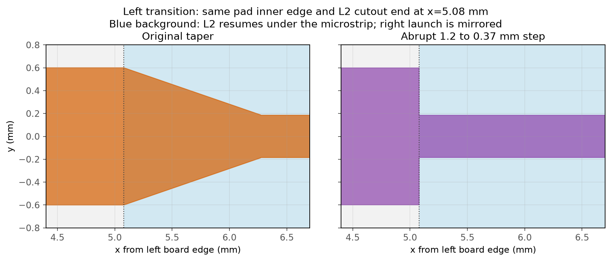

CAD occupancy checks confirm the two taper wings are absent, the narrow strip and full-width pads remain, and signal and ground still form two separate continuous networks. The saved `signal_outline_mm` records the actual replacement polygon.

| GHz | Taper S21, dB | Step S21, dB | Change, dB | Taper S11, dB | Step S11, dB |
|---:|---:|---:|---:|---:|---:|
| 0.5 | -0.12 | -0.12 | +0.00 | -35.89 | -39.94 |
| 1 | -0.16 | -0.16 | +0.00 | -30.05 | -38.85 |
| 1.5 | -0.21 | -0.20 | +0.01 | -25.78 | -44.23 |
| 2 | -0.26 | -0.23 | +0.03 | -21.99 | -38.37 |
| 2.2 | -0.29 | -0.25 | +0.04 | -20.52 | -32.26 |
| 2.3 | -0.31 | -0.26 | +0.04 | -19.80 | -29.94 |
| 2.4 | -0.32 | -0.27 | +0.05 | -19.08 | -27.91 |
| 2.45 | -0.33 | -0.28 | +0.05 | -18.73 | -26.98 |
| 2.5 | -0.34 | -0.28 | +0.06 | -18.38 | -26.09 |
| 2.55 | -0.35 | -0.29 | +0.06 | -18.03 | -25.25 |
| 2.6 | -0.36 | -0.30 | +0.06 | -17.68 | -24.45 |
| 2.65 | -0.37 | -0.31 | +0.07 | -17.34 | -23.68 |
| 2.7 | -0.39 | -0.31 | +0.07 | -17.00 | -22.94 |
| 2.8 | -0.41 | -0.33 | +0.08 | -16.33 | -21.56 |
| 3 | -0.47 | -0.37 | +0.09 | -15.03 | -19.07 |
| 3.5 | -0.67 | -0.55 | +0.12 | -12.04 | -14.04 |
| 4 | -1.18 | -1.07 | +0.11 | -8.96 | -9.67 |
| 5 | -0.90 | -1.00 | -0.11 | -10.98 | -9.88 |
| 5.8 | -0.81 | -1.11 | -0.30 | -12.88 | -9.34 |
| 6 | -0.76 | -1.08 | -0.32 | -14.53 | -9.74 |

### Mesh, checks and reproduction

The step model has 364,293 tetrahedra and 62,023 nodes, using the same mesh size targets and first-order basis as the tapered reference. The frequency sweep took 4.1 minutes. The geometry was remeshed; a mesh-refinement study was not added.

Native modal Z0: 49.253–49.254 Ω; maximum |S21−S12|: 8.49e-13; maximum |S11−S22|: 0.00299; maximum singular value: 0.993647. All plotted results are normalized to 50 Ω at the same coax annuli, with connectors included.

From `C:\Fun\ToyRadar\Frontend\emerge`:

```powershell
.\.venv\Scripts\python.exe -m coupon_10mm.connector_model --l2-opening 4.2 4.8 --transition step --view
.\.venv\Scripts\python.exe -m coupon_10mm.connector_model --l2-opening 4.2 4.8 --transition step --reuse-mesh --solve
.\.venv\Scripts\python.exe -m coupon_10mm.compare_step
```

Raw/native and 50 Ω S, modal data, completed-run metadata and Touchstone export: `result_coax_open_4.2x4.8mm_step.*`.
