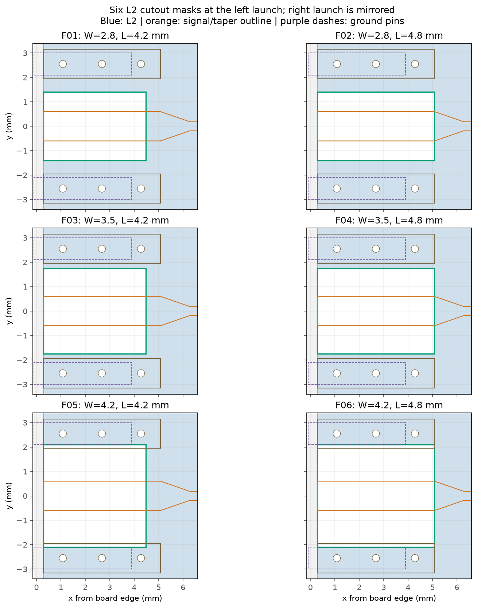
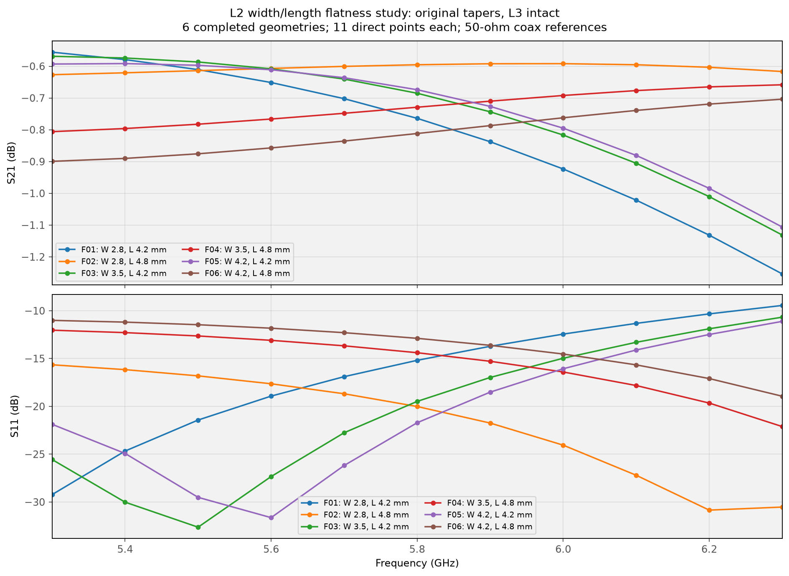
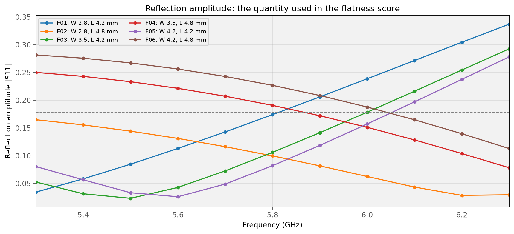
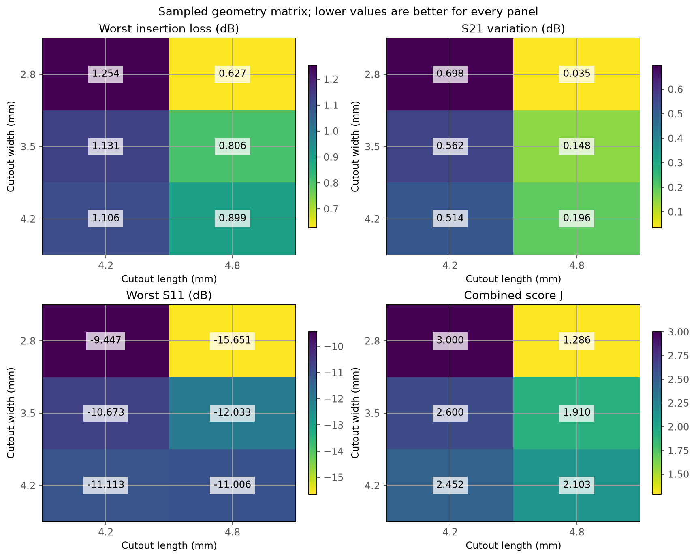
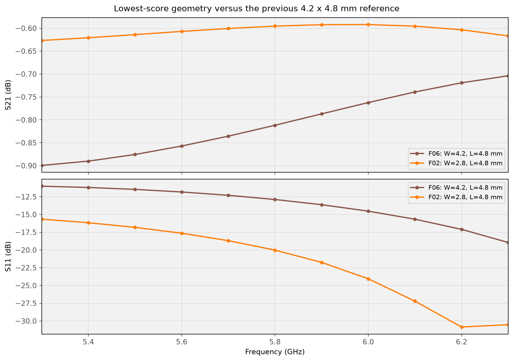
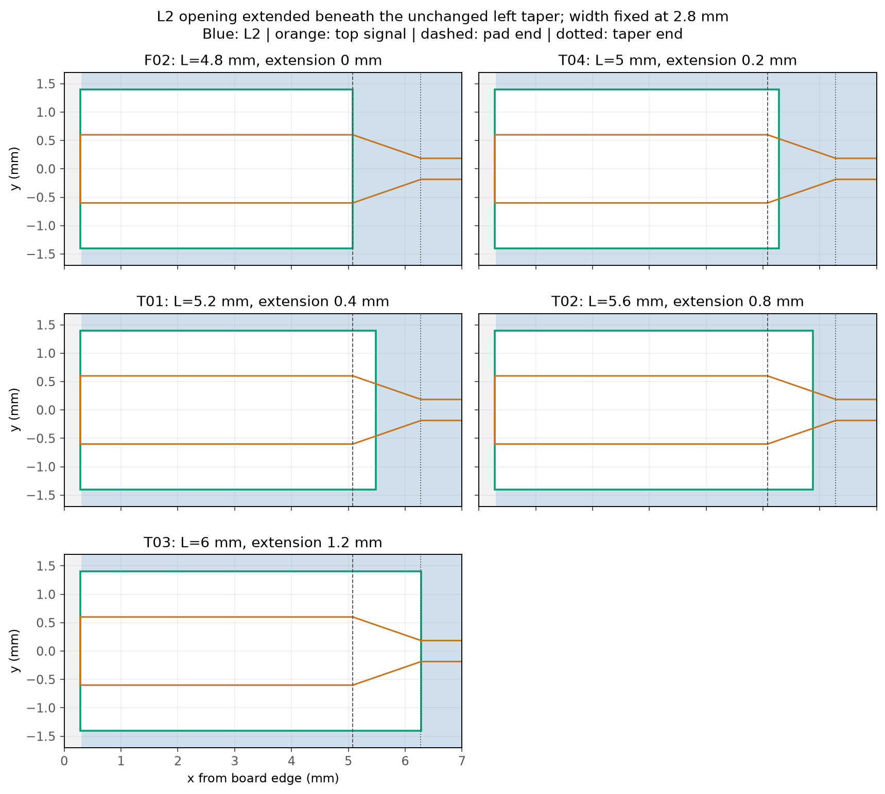
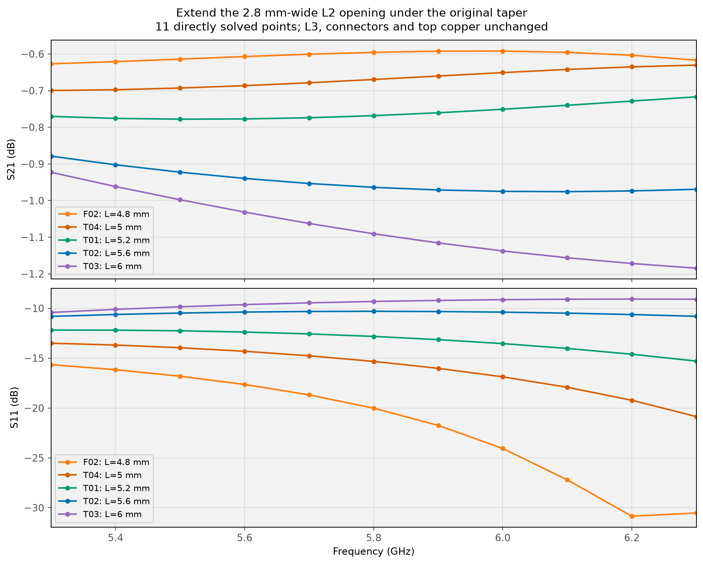
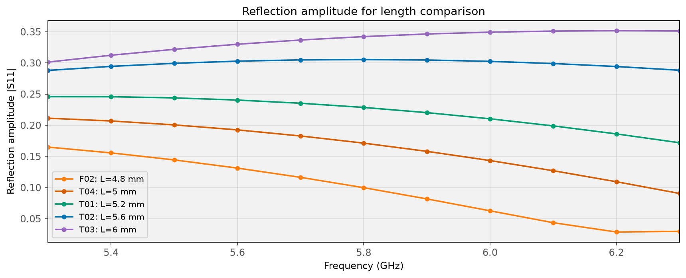

# L2 cutout flatness study: 5.3–6.3 GHz

**Phase 1: 6 of 6 geometries completed; 66 directly solved frequency cases.** This is a six-case grid study, not gradient descent or resonance-frequency tuning. Earlier broadband data are preserved in their original files.

## Question and fixed design

Find a smooth response over the entire **5.3–6.3 GHz** interval, rather than optimizing a deep reflection minimum at one frequency. The application remains 5.8 GHz ±75 MHz. Every geometry is evaluated at **5.3, 5.4, …, 6.3 GHz** (11 equally spaced points, 100 MHz spacing). The two exact application-band edges are not additional solve points in this study.

Original tapers, 4.8 × 1.2 mm pads, 0.37 mm microstrip, simplified BWSMA connectors, all via contacts, intact L3 and bottom ground, FR4 εr=4.5 / tanδ=0.02, finite copper and the air-box boundaries are held fixed. Only the width and length of the two symmetric rectangular L2 copper windows change.



| Width, mm | Length 4.2 mm | Length 4.8 mm |
|---:|---|---|
| 2.8 | F01 | F02 |
| 3.5 | F03 | F04 |
| 4.2 | F05 | F06 — current reference |

Each window starts at the outer signal-pad edge: left x=0.28…0.28+L mm; right x=19.88−L…19.88 mm; y=±W/2. Shortening therefore restores L2 under the **inner** part of each pad. It does not shift the connector or extend the opening under the taper. The widest case stops at the ground pins’ inner edges; all ground vias and L2 beneath the pins are retained.

The width levels test intermediate values between the earlier 1.6 and 4.2 mm trials. The second length tests whether restoring some pad capacitance helps the broad response. This small matrix also exposes width/length interaction.

## Score: useful transmission, low reflection and low variation

For the 11 sampled frequencies, define transmission T in dB and reflection amplitude R:

$$
T_i=20\log_{10}|S_{21,i}|,\qquad R_i=|S_{11,i}|.
$$

$$
L_{\max}=-\min_i T_i,\quad \Delta T=\max_iT_i-\min_iT_i,
\qquad R_{\max}=\max_iR_i,\quad \Delta R=\max_iR_i-\min_iR_i.
$$

The fixed ranking score is:

$$
J=\max\left(\frac{L_{\max}}{1\,\mathrm{dB}},\frac{R_{\max}}{10^{-15/20}}\right)
+0.25\left(\frac{\Delta T}{0.5\,\mathrm{dB}}+\frac{\Delta R}{0.10}\right).
$$

**Lower is better.** The first term balances worst-case insertion loss and reflection; the second explicitly penalizes variation. The scales (1 dB, −15 dB reflection, 0.5 dB transmission span and 0.10 amplitude span) are comparison scales, not user-specified acceptance limits. The formula and weights were fixed before examining the sweep results. A flat but badly matched or highly attenuating response cannot win on flatness alone.

Reflection flatness uses amplitude rather than its dB span: a harmless deep S11 null can produce a huge dB range. Worst S11 and its dB span are still preserved in the metrics. The Pareto flag means no other case is at least as good in all four metrics and strictly better in one. Full metrics are shown so the tradeoff does not depend only on this scalar score.

| Rank | ID | W × L, mm | Worst loss, dB ↓ | S21 span, dB ↓ | Worst S11, dB ↓ | amplitude span ↓ | J ↓ | Pareto |
|---:|---|---|---:|---:|---:|---:|---:|---|
| 1 | F02 | 2.8 × 4.8 | 0.627 | 0.035 | -15.65 | 0.1363 | 1.286 | yes |
| 2 | F04 | 3.5 × 4.8 | 0.806 | 0.148 | -12.03 | 0.1718 | 1.910 | no |
| 3 | F06 | 4.2 × 4.8 | 0.899 | 0.196 | -11.01 | 0.1686 | 2.103 | no |
| 4 | F05 | 4.2 × 4.2 | 1.106 | 0.514 | -11.11 | 0.2520 | 2.452 | no |
| 5 | F03 | 3.5 × 4.2 | 1.131 | 0.562 | -10.67 | 0.2693 | 2.600 | no |
| 6 | F01 | 2.8 × 4.2 | 1.254 | 0.698 | -9.45 | 0.3025 | 3.000 | no |

## Result

The lowest score among completed cases is **F02: 2.8 × 4.8 mm**. Worst sampled insertion loss: **0.627 dB**; S21 span: **0.035 dB**; worst S11: **-15.65 dB**. This identifies the best sampled member of this small matrix, not a continuous optimum.

The smallest S21 span is from **F02**; the smallest reflection-amplitude span is from **F02**. These individual flatness minima are reported separately from the combined ranking.







The selected case improves all four criteria over every other tested case. Its preference therefore does not depend on the chosen positive score weights.

Keeping the full 4.8 mm window length reduces worst insertion loss and both amplitude-variation metrics at every tested width. Worst S11 also improves at widths 2.8 and 3.5 mm; at 4.2 mm it instead worsens slightly (−11.11 to −11.01 dB). Among full-length windows, 2.8 mm width improves all four criteria over 3.5 and 4.2 mm. These are observations within this matrix, not a general monotonic design rule.

**S11 is not flat in dB:** the selected case has a 15.20 dB range, including a deep minimum. What improves is its worst reflection and its amplitude span: reflected power stays at or below 2.72% at all 11 points. The design is not selected because of that deep minimum. The flatter transmission and low worst-case reflection are the useful result.



| Metric | F06 reference: 4.2 × 4.8 mm | Lowest-score case |
|---|---:|---:|
| Worst loss, dB | 0.899 | 0.627 |
| S21 span, dB | 0.196 | 0.035 |
| Worst S11, dB | -11.01 | -15.65 |
| Reflection amplitude span | 0.1686 | 0.1363 |
| S21 at 5.8 GHz, dB | -0.812 | -0.595 |
| S11 at 5.8 GHz, dB | -12.88 | -20.01 |

The selected case improves all four component metrics over F06; this preference is not caused only by the particular score weights.

| GHz | Selected S21, dB | F06 S21, dB | Selected S11, dB | F06 S11, dB |
|---:|---:|---:|---:|---:|
| 5.3 | -0.627 | -0.899 | -15.65 | -11.01 |
| 5.4 | -0.621 | -0.890 | -16.16 | -11.19 |
| 5.5 | -0.614 | -0.876 | -16.81 | -11.46 |
| 5.6 | -0.607 | -0.857 | -17.64 | -11.82 |
| 5.7 | -0.601 | -0.836 | -18.68 | -12.29 |
| 5.8 | -0.595 | -0.812 | -20.01 | -12.88 |
| 5.9 | -0.592 | -0.787 | -21.74 | -13.62 |
| 6 | -0.592 | -0.762 | -24.05 | -14.53 |
| 6.1 | -0.595 | -0.739 | -27.20 | -15.66 |
| 6.2 | -0.603 | -0.719 | -30.85 | -17.09 |
| 6.3 | -0.617 | -0.704 | -30.53 | -18.94 |

## Numerical checks and scope

| ID | Tetrahedra | Nodes | Solve, min | Max singular value | Reciprocity error | Symmetry error |
|---|---:|---:|---:|---:|---:|---:|
| F01 | 364,163 | 62,032 | 2.5 | 0.960584 | 2.5e-13 | 0.00426 |
| F02 | 362,870 | 61,803 | 2.5 | 0.956564 | 2.4e-13 | 0.00446 |
| F03 | 363,356 | 61,902 | 2.0 | 0.961052 | 2.8e-13 | 0.00468 |
| F04 | 362,375 | 61,731 | 1.9 | 0.956574 | 2.8e-13 | 0.00276 |
| F05 | 363,229 | 61,880 | 1.9 | 0.960726 | 2.7e-13 | 0.00262 |
| F06 | 361,630 | 61,620 | 2.0 | 0.955517 | 2.3e-13 | 0.00304 |

The repeated F06 solve agrees with its earlier broadband result at 5.8, 6 GHz: maximum complex S-matrix difference 3.12e-13.

All cases use first-order FEM with the same mesh targets: 0.06 mm signal edges, 0.18 mm signal surfaces, 0.90 mm substrate, 0.45 mm connector surfaces and 0.22 mm coax port faces. Matching saved geometry meshes may be reused; new geometries are remeshed. The 11-point F06 solve is separate from its earlier 20-point broadband dataset. Every curve uses a common 50 Ω reference at the same coax planes, with both connectors included.

Each case invokes one EMerge `run_sweep()` containing all 11 frequencies, with one frequency matrix group at a time to limit memory. Cases run sequentially. CAD connectivity and L2/L3 occupancy checks run before meshing.

The 100 MHz grid screens broad variation; it does not prove that nothing happens between points. Flatness over this wider interval is a practical way to avoid selecting a narrow nominal optimum, but is not an εr tolerance simulation. No dielectric corners, L3 openings or mesh convergence study were added. The connector and contact assumptions remain those in [the geometry report](03_CONNECTOR_GEOMETRY.md).

## Files and reproduction

`sweep_flatness.py` defines and runs the six cases; `report_flatness.py` contains the fixed scoring rule and generates this report. The machine-readable matrix and numerical checks are in `sweep_flatness_5p3to6p3/metrics.json`; `progress.json` records runner status. Result stems include `_5p3to6p3GHz`, preserving all earlier datasets. Native S, 50 Ω S, Z0 and β are stored in each NPZ, with completed-run metadata in JSON and a 50 Ω Touchstone export.

From `C:\Fun\ToyRadar\Frontend\emerge`:

```powershell
.\.venv\Scripts\python.exe -m coupon_10mm.sweep_flatness
.\.venv\Scripts\python.exe -m coupon_10mm.report_flatness
# During a run, show only completed cases:
.\.venv\Scripts\python.exe -m coupon_10mm.report_flatness --partial
```

The runner skips already completed matching cases on restart. Logs and heavy meshes are excluded from Git; small results and plots remain available.

<!-- EXTENDED-TAPER-CUTOUT-STUDY -->

## Phase 2: extend the opening beneath the taper

**4 of 4 new geometries complete.** Together with phase 1: **10 unique geometries and 110 directly solved frequency cases** on the same 11-point grid. F02 is reused as the reference, not solved again.

Width stays **2.8 mm**. Lengths are **5.0, 5.2, 5.6 and 6.0 mm**, extending 0.2, 0.4, 0.8 and 1.2 mm beyond each pad’s inner edge. Top copper, original tapers, connector geometry, L3 and bottom ground remain unchanged. The left windows still start at x=0.28 mm; only their inner ends move. The right windows are mirrored about x=10.08 mm.

The original taper ends at approximately x=6.275 mm on the left. The 6.0 mm window ends at x=6.28 mm: it covers the full approximately 1.195 mm taper and extends about 5 µm into the uniform line. The 5.2 and 5.6 mm windows end at x=5.48 and 5.88 mm respectively. T04 (5.0 mm), added after the first three extensions, ends at x=5.28 mm: just 0.2 mm beneath the taper.



The physical tradeoff is different from widening only beneath the pad: this also removes the nearby return plane beneath part of the impedance transition. Both local capacitance and return-current inductance change. More removal is therefore not automatically better.

| ID | Length, mm | Worst loss, dB ↓ | S21 span, dB ↓ | Worst S11, dB ↓ | S11 dB span | Amplitude span ↓ | J ↓ |
|---|---:|---:|---:|---:|---:|---:|---:|
| F02 | 4.8 | 0.627 | 0.035 | -15.65 | 15.20 | 0.1363 | 1.286 |
| T04 | 5 | 0.700 | 0.069 | -13.50 | 7.36 | 0.1208 | 1.525 |
| T01 | 5.2 | 0.778 | 0.061 | -12.18 | 3.11 | 0.0740 | 1.598 |
| T02 | 5.6 | 0.976 | 0.097 | -10.30 | 0.51 | 0.0175 | 1.810 |
| T03 | 6 | 1.185 | 0.262 | -9.08 | 1.34 | 0.0504 | 2.235 |





The lowest score among all 10 completed geometries is **F02: 2.8 × 4.8 mm**. The score and its four component metrics are unchanged from phase 1.

Non-dominated cases across the combined study: **F02, T04, T01, T02**. An extended opening may give flatter reflection but a worse reflection level; the full component metrics show that tradeoff separately from the score.

### Interpretation

**The added 5.0 mm case (T04)** gives 0.700 dB worst insertion loss, 0.069 dB S21 span, and -13.50 dB worst S11. Its reflection-amplitude span is 0.1208; its S11 span in dB is 7.36 dB.

Among these five lengths, the metric minima are: worst loss — F02; S21 variation — F02; worst reflection — F02; reflection variation — T02. These are separate objectives: flatter S11 can mean a flatter but higher reflected signal.

The unchanged balanced score selects **F02, 2.8 × 4.8 mm**, across all 10 geometries. T02 (5.6 mm) remains the alternative for very flat S11 (0.51 dB span), accepting about 10.3 dB return loss and 0.976 dB worst insertion loss. T03 (6.0 mm) is worse than T02 in all four criteria. Extending the opening as far as possible gives no benefit in this comparison.

### At 5.8 GHz

| ID | S21, dB | S11, dB | Transmitted power, % | Reflected power, % |
|---|---:|---:|---:|---:|
| F02 | -0.595 | -20.01 | 87.19 | 1.00 |
| T04 | -0.669 | -15.32 | 85.71 | 2.93 |
| T01 | -0.768 | -12.82 | 83.79 | 5.22 |
| T02 | -0.964 | -10.30 | 80.10 | 9.33 |
| T03 | -1.091 | -9.31 | 77.79 | 11.71 |

### Mesh and checks

| ID | Tetrahedra | Solve, min | Max singular value | Reciprocity error |
|---|---:|---:|---:|---:|
| F02 | 362,870 | 2.5 | 0.956564 | 2.4e-13 |
| T04 | 362,441 | 2.0 | 0.954939 | 1.7e-13 |
| T01 | 361,790 | 2.5 | 0.953152 | 1.7e-13 |
| T02 | 361,623 | 2.5 | 0.953826 | 1.9e-13 |
| T03 | 360,954 | 2.6 | 0.956593 | 1.5e-13 |

Mesh size targets, first-order basis, material assumptions, air box and coax references are held fixed. New length geometries are remeshed. The occupancy checks now verify that L2 is absent inside the extended windows and present beyond their inner ends; L3 remains below the windows. Ground-pin support, via connections and separate continuous signal/ground networks are checked as before. These are nominal-material trials, not dielectric-tolerance or mesh-convergence simulations.

### Reproduce the extension study

From `C:\Fun\ToyRadar\Frontend\emerge`:

```powershell
.\.venv\Scripts\python.exe -m coupon_10mm.sweep_taper_cutout
.\.venv\Scripts\python.exe -m coupon_10mm.report_taper_cutout
```

Individual cases use `--l2-opening 2.8 LENGTH --frequency-grid flatness --solve`. Raw S, 50 Ω S, Z0 and β are saved in the corresponding `result_coax_open_2.8xLENGTHmm_5p3to6p3GHz.npz`; matching JSON records the completed solve and `.s2p` is the 50 Ω export. Progress, metrics and figures are under `sweep_taper_cutout_5p3to6p3/`.

### Broadband verification

[Selected 2.8 × 4.8 mm design: 0.5–6.5 GHz check](07_BROADBAND_CHECK.md) compares the wider response with the saved intact-L2 and wide-cutout controls.

### Mesh refinement

[First-order mesh comparison for the selected geometry](08_MESH_REFINEMENT.md) compares standard and refined targets over the same 11 frequencies.
