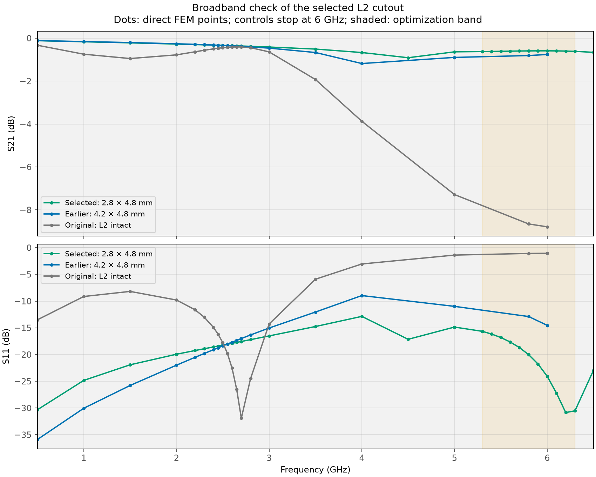
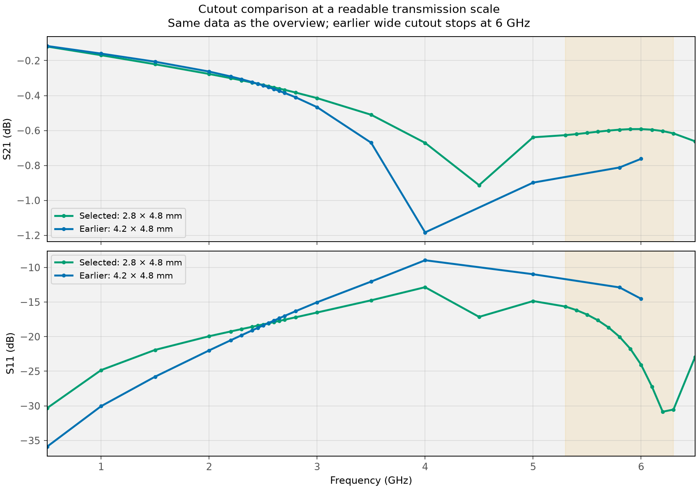

# Broadband verification: 2.8 × 4.8 mm L2 cutout

**Completed: one geometry, 31 directly solved frequencies over 0.5–6.5 GHz.** The original tapers, L3 and simplified BWSMA connectors are retained. The saved mesh of the selected F02 geometry is reused.

## Response



| Range | Worst insertion loss, dB | S21 span, dB | Worst S11, dB |
|---|---:|---:|---:|
| 0.5–6.5 GHz | 0.913 | 0.794 | -12.85 |
| 5.3–6.3 GHz | 0.627 | 0.035 | -15.65 |

The worst sampled broadband insertion loss occurs at **4.5 GHz**; the worst sampled S11 at **4 GHz**.

**Retain the 2.8 × 4.8 mm design for verification.** No deep transmission notch appears at the sampled frequencies. There is a broad insertion-loss depression around 4.5 GHz, but it remains below 1 dB at the sampled points. The original launch’s severe upper-band roll-off is absent. The 5.3–6.3 GHz response repeats the earlier optimization result; the next check is mesh refinement of this fixed geometry.



### Selected frequencies

| Frequency, GHz | Selected S21, dB | Selected S11, dB | Wide cutout S21, dB | Intact L2 S21, dB |
|---|---:|---:|---:|---:|
| 1 | -0.169 | -24.83 | -0.160 | -0.749 |
| 2.6 | -0.353 | -17.89 | -0.363 | -0.416 |
| 4 | -0.671 | -12.85 | -1.183 | -3.872 |
| 5 | -0.639 | -14.85 | -0.899 | -7.286 |
| 5.3 | -0.627 | -15.65 | — | — |
| 5.8 | -0.595 | -20.01 | -0.812 | -8.654 |
| 6 | -0.592 | -24.05 | -0.762 | -8.788 |
| 6.3 | -0.617 | -30.53 | — | — |
| 6.5 | -0.662 | -22.93 | — | — |

## Sampling and numerical checks

Grid, GHz: 0.5, 1, 1.5, 2, 2.2, 2.3, 2.4, 2.45, 2.5, 2.55, 2.6, 2.65, 2.7, 2.8, 3, 3.5, 4, 4.5, 5, 5.3, 5.4, 5.5, 5.6, 5.7, 5.8, 5.9, 6, 6.1, 6.2, 6.3, 6.5.

This combines the earlier broadband and optimization grids, adding 4.5 and 6.5 GHz. Lines only connect directly solved points; no extra resonances are inferred between samples. The two saved controls cover 0.5–6 GHz and are plotted only over that range.

The 11 repeated optimization-band points agree with the preceding F02 sweep to **3.96e-13** maximum absolute complex S difference. The reused mesh has **362,870 tetrahedra** and **61,803 nodes**; first-order basis, εr=4.5, tanδ=0.02. Solve time: 5.4 min.

Maximum singular value of S: 0.994103; maximum reciprocity error: 1.29e-12. All results use 50 Ω coax reference planes and include both connectors.

This checks the sampled broadband response with the existing mesh. Mesh refinement and dielectric sensitivity remain separate verification steps.

## Reproduce

From `C:\Fun\ToyRadar\Frontend\emerge`:

```powershell
.\.venv\Scripts\python.exe -m coupon_10mm.connector_model --l2-opening 2.8 4.8 --frequency-grid broadband-check --reuse-mesh --solve
.\.venv\Scripts\python.exe -m coupon_10mm.report_broadband_check
```

Results: `result_coax_open_2.8x4.8mm_0p5to6p5GHz.npz`, matching JSON and 50 Ω `.s2p`. The `_0p5to6p5GHz` suffix preserves the previous datasets. [Return to the geometry sweep](06_L2_CUTOUT_FLATNESS_SWEEP.md).
