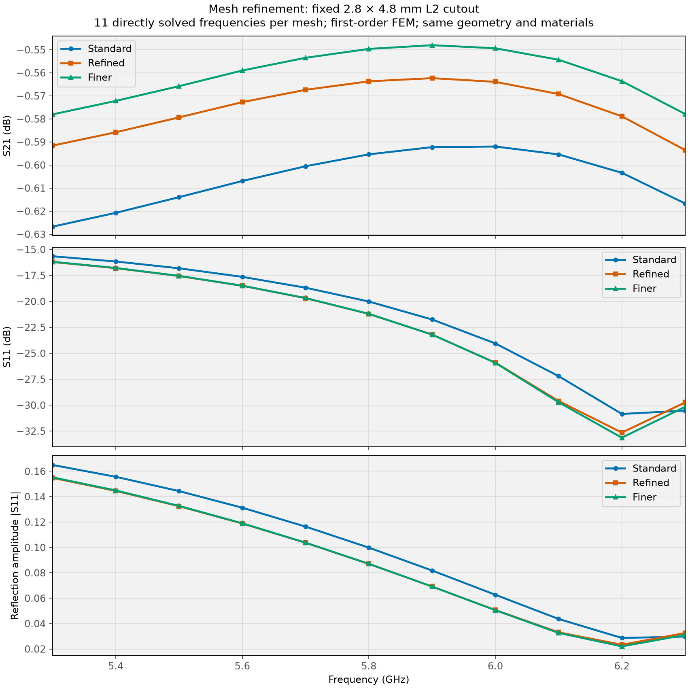
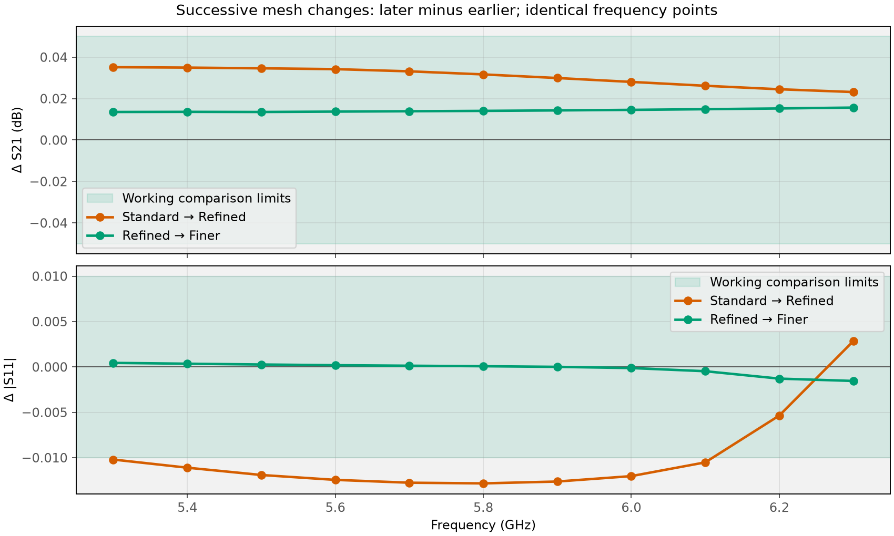

# Mesh refinement: selected L2 cutout

**The last refinement is within both working comparison limits.**

**3 meshes, 11 directly solved frequencies per mesh over 5.3–6.3 GHz.** The standard result is reused; 2 new meshes add 22 frequency solves. For Refined → Finer, maximum pointwise change is **0.0157 dB in S21** and **0.0015 in |S11|**. Working limits are 0.05 dB and 0.01 respectively. These were selected before inspecting the first refinement and are numerical comparison criteria, not fabrication or product acceptance limits.

**Retain the 2.8 × 4.8 mm geometry.** The smaller changes in the last refinement support using the finest result as the present numerical reference. Further mesh refinement is not needed for the current geometry decision; material sensitivity is the next useful check.

## Mesh definitions

The geometry stays at **2.8 × 4.8 mm**, with original tapers, L3 intact and the same simplified BWSMA connectors. The first-order basis, material parameters, air box and coax reference planes stay fixed.

| Mesh target / actual mesh | Standard | Refined | Finer |
|---|---:|---:|---:|
| Substrate volume, mm | 0.900 | 0.750 | 0.600 |
| Signal surface, mm | 0.180 | 0.150 | 0.120 |
| Signal edge, mm | 0.060 | 0.045 | 0.035 |
| Connector surface, mm | 0.450 | 0.375 | 0.300 |
| Coax port face, mm | 0.220 | 0.180 | 0.150 |
| Tetrahedra | 362,870 | 480,870 | 649,089 |
| Nodes | 61,803 | 81,279 | 108,921 |
| Solve time, min | 2.5 | 3.3 | 5.3 |

The global wavelength-resolution setting, mesh growth rates and maximum boundary-size cap remain fixed. Targets guide local refinement; actual element sizes also depend on geometry and mesher constraints. Separate `_mesh_refined` and `_mesh_finer` folders/suffixes preserve all runs.

## Response comparison



| Metric over 5.3–6.3 GHz | Standard | Refined | Finer |
|---|---:|---:|---:|
| Worst insertion loss, dB | 0.6267 | 0.5935 | 0.5780 |
| S21 span, dB | 0.0348 | 0.0312 | 0.0300 |
| Worst S11, dB | -15.6512 | -16.2059 | -16.1810 |
| Reflection amplitude span | 0.1363 | 0.1315 | 0.1332 |

| Successive comparison | Max Δ S21, dB | Max Δ reflection amplitude |
|---|---:|---:|
| Standard → Refined | 0.0352 | 0.0128 |
| Refined → Finer | 0.0157 | 0.0015 |



The first refinement exceeded the 0.01 reflection-amplitude limit (0.0128), although S21 changed by only 0.0352 dB. This motivated the additional finer mesh. S11 in dB can move appreciably near a deep minimum even when absolute reflected amplitude changes little; both representations are shown.

### Direct frequency results

| GHz | Standard S21, dB | Refined S21, dB | Finer S21, dB | Standard S11, dB | Refined S11, dB | Finer S11, dB |
|---:|---:|---:|---:|---:|---:|---:|
| 5.3 | -0.627 | -0.592 | -0.578 | -15.65 | -16.21 | -16.18 |
| 5.4 | -0.621 | -0.586 | -0.572 | -16.16 | -16.80 | -16.78 |
| 5.5 | -0.614 | -0.579 | -0.566 | -16.81 | -17.56 | -17.54 |
| 5.6 | -0.607 | -0.573 | -0.559 | -17.64 | -18.50 | -18.49 |
| 5.7 | -0.601 | -0.567 | -0.553 | -18.68 | -19.69 | -19.68 |
| 5.8 | -0.595 | -0.564 | -0.550 | -20.01 | -21.21 | -21.20 |
| 5.9 | -0.592 | -0.562 | -0.548 | -21.74 | -23.20 | -23.20 |
| 6 | -0.592 | -0.564 | -0.549 | -24.05 | -25.90 | -25.93 |
| 6.1 | -0.595 | -0.569 | -0.554 | -27.20 | -29.60 | -29.72 |
| 6.2 | -0.603 | -0.579 | -0.564 | -30.85 | -32.64 | -33.14 |
| 6.3 | -0.617 | -0.594 | -0.578 | -30.53 | -29.74 | -30.16 |

## Checks and interpretation

Saved geometry, connector, layer, air-box, port, material-assumption and element-order metadata agree. Each later mesh has smaller targets and more tetrahedra. CAD checks verify separate continuous signal/ground networks, complete coax annuli and the intended L2 cutouts.

| Numerical check | Standard | Refined | Finer |
|---|---:|---:|---:|
| Maximum singular value of S | 0.956564 | 0.957514 | 0.958824 |
| Maximum reciprocity error | 2.35267e-13 | 2.21925e-13 | 2.49381e-13 |
| Maximum mirror-symmetry error | 0.00446433 | 0.00284604 | 0.000972396 |
| Port Z0 real range, Ω | 49.253–49.254 | 49.540–49.658 | 49.530–49.566 |

All S matrices are renormalized to 50 Ω. A small successive change supports numerical stability for this particular model; it does not bound the exact solution’s error or validate the simplified connector against hardware. Air-box, polynomial-order and material-sensitivity checks are separate. The earlier broadband report uses the standard mesh; the finer checks cover only 5.3–6.3 GHz.

## Reproduce

From `C:\Fun\ToyRadar\Frontend\emerge`:

```powershell
.\.venv\Scripts\python.exe -m coupon_10mm.connector_model --l2-opening 2.8 4.8 --frequency-grid flatness --mesh-profile refined --solve
.\.venv\Scripts\python.exe -m coupon_10mm.connector_model --l2-opening 2.8 4.8 --frequency-grid flatness --mesh-profile finer --solve
.\.venv\Scripts\python.exe -m coupon_10mm.report_mesh_refinement
```

To reuse a mesh, add `--reuse-mesh` with the same `--mesh-profile`. To inspect it without solving, replace `--solve` with `--reuse-mesh --view-mesh`. Raw S, 50 Ω S, port Z0 and β are saved in each corresponding NPZ; matching JSON records completed-run metadata and `.s2p` is the 50 Ω export. [Geometry sweep](06_L2_CUTOUT_FLATNESS_SWEEP.md) · [Broadband check](07_BROADBAND_CHECK.md).
