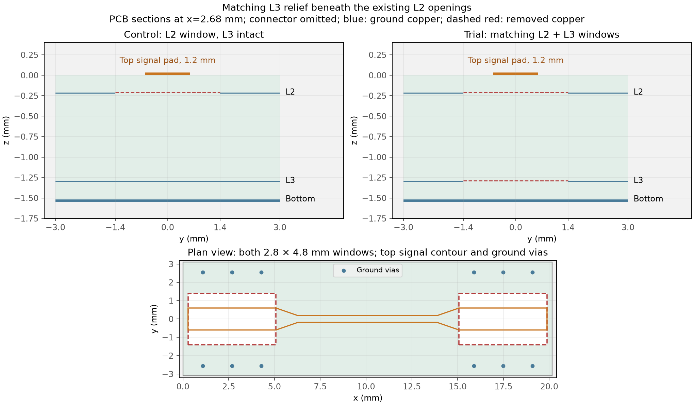
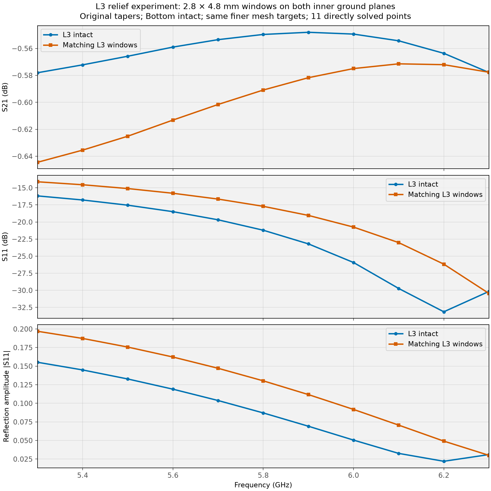

# L3 cutout experiment

**Retaining L3 is better in all four nominal comparison metrics.**

**One new geometry, 11 new frequency solves over 5.3–6.3 GHz.** The control is the saved finest-mesh result from [the refinement study](08_MESH_REFINEMENT.md); it was not solved again.

## Geometry: only L3 changes

Remove L3 copper directly beneath the existing **2.8 × 4.8 mm L2 windows**: left x=0.28…5.08 mm, right x=15.08…19.88 mm, y=±1.4 mm. The rest of L3, Bottom copper, dielectric, original top pads/tapers, connector contacts and ground vias remain. These are copper clearances, not board slots. The entire L3 layer is not removed.



L3 copper spans approximately z=−1.2906…−1.3058 mm. Bottom spans z=−1.5162…−1.5512 mm and becomes the nearest continuous ground plane directly under the two aligned windows. Return currents can also flow around the windows through the remaining L2/L3 copper.

Removing more ground can reduce local capacitance and change return-path inductance. The net effect is evaluated by the complete connector-inclusive S-matrix; it is not assumed to improve the match.

## Response



| Metric, 5.3–6.3 GHz | L3 intact | Matching L3 windows |
|---|---:|---:|
| Worst insertion loss, dB | 0.5780 | 0.6445 |
| S21 span, dB | 0.0300 | 0.0731 |
| Worst S11, dB | -16.1810 | -14.1146 |
| Reflection amplitude span | 0.1332 | 0.1669 |
| Fixed score J | 1.2209 | 1.5611 |

The unchanged score from the geometry search favors **L2 windows with L3 intact**. Maximum pointwise differences are **0.0664 dB in S21** and **0.0434 in |S11|**.

For scale, the last mesh-refinement step on the intact-L3 control changed S21 by at most 0.0157 dB and |S11| by 0.00155. Those values are a reference for numerical sensitivity, not error bounds for this new geometry.

**Keep L3 intact for the current design.** The aligned L3 windows worsen worst-case loss, transmission variation, worst reflection and reflection-amplitude variation. The curves approach each other near the upper band edge, but the low-frequency end deteriorates. This trial gives no reason to add these L3 windows. It does not rule out every possible L3 clearance shape; that would require another geometry search.

### Direct frequency results

| GHz | Intact S21, dB | L3-window S21, dB | Intact S11, dB | L3-window S11, dB |
|---:|---:|---:|---:|---:|
| 5.3 | -0.578 | -0.644 | -16.18 | -14.11 |
| 5.4 | -0.572 | -0.635 | -16.78 | -14.55 |
| 5.5 | -0.566 | -0.625 | -17.54 | -15.11 |
| 5.6 | -0.559 | -0.613 | -18.49 | -15.80 |
| 5.7 | -0.553 | -0.602 | -19.68 | -16.65 |
| 5.8 | -0.550 | -0.591 | -21.20 | -17.70 |
| 5.9 | -0.548 | -0.582 | -23.20 | -19.03 |
| 6 | -0.549 | -0.575 | -25.93 | -20.74 |
| 6.1 | -0.554 | -0.571 | -29.72 | -23.01 |
| 6.2 | -0.564 | -0.572 | -33.14 | -26.17 |
| 6.3 | -0.578 | -0.578 | -30.16 | -30.45 |

## Mesh and checks

Both cases use first-order FEM and the same finer targets: substrate 0.600 mm, signal surface 0.120 mm, signal edge 0.035 mm, connector surface 0.300 mm, coax port 0.150 mm. The changed geometry is remeshed.

| Run | Tetrahedra | Nodes | Solve time, min | Max singular value | Reciprocity error |
|---|---:|---:|---:|---:|---:|
| L3 intact | 649,089 | 108,921 | 5.3 | 0.958824 | 2.49e-13 |
| Matching L3 windows | 648,248 | 108,781 | 5.2 | 0.959476 | 2.73e-13 |

CAD checks verify empty L2/L3 window centres and inner ends, copper beside and past the windows, L3 beneath the ground pins, Bottom beneath the windows, separate continuous signal/ground networks and complete coax annuli. Saved metadata confirm unchanged geometry elsewhere, materials, air box, frequency grid and mesh targets. S is referenced to 50 Ω at the coax planes and includes both connectors.

This is one nominal-material L3 geometry, not an L3 optimization or a mesh-refinement study of this new geometry. No Bottom openings, dielectric changes or additional frequency points were simulated.

## Reproduce

From `C:\Fun\ToyRadar\Frontend\emerge`:

```powershell
.\.venv\Scripts\python.exe -m coupon_10mm.connector_model --l2-opening 2.8 4.8 --l3-opening --frequency-grid flatness --mesh-profile finer --solve
.\.venv\Scripts\python.exe -m coupon_10mm.report_l3_cutout
```

For interactive geometry, replace `--solve` with `--view`; for the saved mesh, replace it with `--reuse-mesh --view-mesh`. Results use `result_coax_open_2.8x4.8mm_l3_open_5p3to6p3GHz_mesh_finer.npz`, matching JSON and 50 Ω `.s2p`; the `_l3_open` name keeps them separate from the intact-L3 reference. [Report index](index.md).
