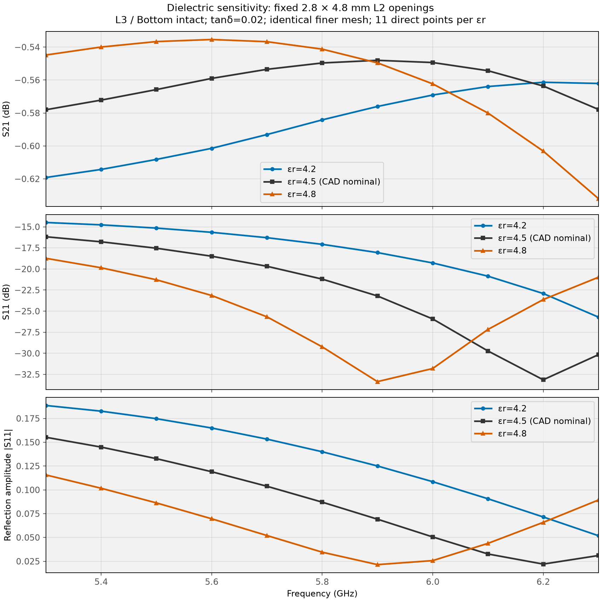
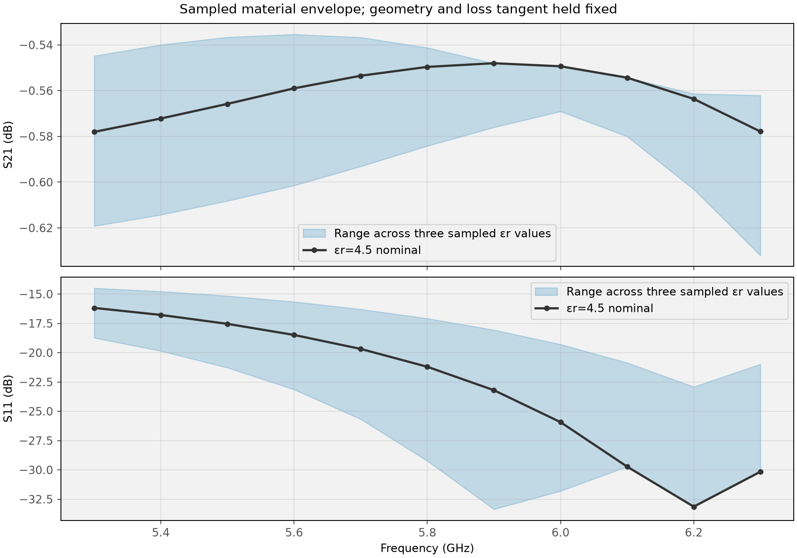

# Dielectric sensitivity of the selected L2 cutout

**Two new material sweeps, 22 new frequency solves.** The εr=4.5 nominal result is reused from [mesh refinement](08_MESH_REFINEMENT.md). Each of the three εr values is evaluated at the same 11 points from 5.3 to 6.3 GHz, on the same saved finer mesh.

## Range and fixed parameters

The [coupon board stack](https://github.com/olddudealex/funrad/blob/main/Frontend/kicad/FrontendPCBCoupon/FrontendPCBCoupon.kicad_pcb) specifies εr=4.5 for its PCB dielectric layers; the outer dielectrics are named 7628-FR4. No verified manufacturing tolerance interval was found in the repository. **4.2, 4.5 and 4.8** are an exploratory ±0.3 (±6.7%) sensitivity range around that CAD nominal, not supplier limits.

| Parameter | Setting |
|---|---|
| PCB εr | 4.2 / 4.5 / 4.8; uniform and frequency independent in each run |
| PCB loss tangent | 0.020 in all cases |
| L2 windows | Two symmetric 2.8 × 4.8 mm windows |
| L3 / Bottom | Intact |
| Signal transition | Original tapers; all copper and via geometry fixed |
| Connector | Same simplified BWSMA; PTFE εr=2.1 unchanged |
| Mesh | Same saved first-order finer mesh; no remeshing |
| Frequency grid | 5.3, 5.4, …, 6.3 GHz |

The model uses one homogeneous FR4 substrate volume, so all PCB dielectric regions change together. This does not model weave, anisotropy, layer-to-layer variations or dielectric dispersion. Holding tanδ fixed isolates εr as the input change; it does not hold dielectric attenuation fixed, because field distribution and complex permittivity also depend on εr.

## Results



| εr | Worst insertion loss, dB | S21 span, dB | Worst S11, dB | Reflection amplitude span |
|---:|---:|---:|---:|---:|
| 4.2 | 0.6192 | 0.0579 | -14.49 | 0.1368 |
| 4.5 | 0.5780 | 0.0300 | -16.18 | 0.1332 |
| 4.8 | 0.6320 | 0.0967 | -18.74 | 0.0942 |

Across these three sampled material cases, worst insertion loss is **0.632 dB** and worst S11 is **-14.49 dB**. These are results across the sampled frequencies and εr values, not continuous tolerance bounds.

**Retain the current geometry for a revised coupon.** At every sampled point, changing εr moves S21 by no more than 0.054 dB from nominal. Transmission remains smooth over the tested band. The sampled reflection minimum moves from the upper band edge at εr=4.2 to 6.2 GHz nominally and 5.9 GHz at εr=4.8. Matching is material-sensitive, but this range does not produce a sampled transmission collapse. These results support testing the fixed geometry in hardware without tuning to one deep nominal reflection minimum.



### Centre frequency and movement of the reflection minimum

| εr | S21 at 5.8 GHz, dB | S11 at 5.8 GHz, dB | Lowest sampled S11 at, GHz | Max S21 change from nominal, dB |
|---:|---:|---:|---:|---:|
| 4.2 | -0.584 | -17.08 | 6.3 | 0.0425 |
| 4.5 | -0.550 | -21.20 | 6.2 | 0.0000 |
| 4.8 | -0.541 | -29.23 | 5.9 | 0.0542 |

The minimum is located only on the 100 MHz sample grid. A minimum at a band edge is not a claim that the true minimum lies at that edge. Assess the whole-band loss and reflection levels rather than the depth of one minimum. The two exact 5.8 GHz ±75 MHz application edges are not additional solve points.

## Numerical checks

All three runs use **649,089 tetrahedra / 108,921 nodes**. Saved metadata match for geometry, connector, layers, ports, air box, mesh targets, node/element counts and basis order. The only changed physical input is PCB εr; tanδ, copper conductivity and PTFE properties remain fixed. Existing meshes are reused deliberately to avoid adding remeshing differences.

| εr | Solve, min | Max singular value | Reciprocity error | Port Z0 real range, Ω |
|---:|---:|---:|---:|---:|
| 4.2 | 5.3 | 0.959117 | 2.49e-13 | 49.530–49.566 |
| 4.5 | 5.3 | 0.958824 | 2.49e-13 | 49.530–49.566 |
| 4.8 | 5.4 | 0.958552 | 1.92e-13 | 49.530–49.566 |

All responses use 50 Ω coax reference planes and include both connectors. No material values were fitted to measurements. The mesh was refined at nominal εr; its convergence was not repeated separately at each material corner.

### Port-search diagnostic

The first εr=4.2 attempt stopped before frequency solves because the generic iterative port search found no mode. The successful corner runs explicitly target the analytical uniform-PTFE coax TEM index sqrt(2.1). This changes the eigensolver search target, not the port geometry or electromagnetic model. Port Z0 and β are checked against the saved nominal arrays, each within 1e−6 relative/absolute comparison tolerance. The failed attempt is excluded from the 22 completed new frequency solves.

## Reproduce

From `C:\Fun\ToyRadar\Frontend\emerge`:

```powershell
.\.venv\Scripts\python.exe -m coupon_10mm.sweep_dielectric
.\.venv\Scripts\python.exe -m coupon_10mm.report_dielectric
```

The runner is sequential and resumable; it skips completed matching corners and reuses the saved nominal result. The saved finer mesh and completed nominal reference from report 08 are prerequisites. On a fresh checkout without that mesh, first regenerate the nominal finer-mesh run using the commands in report 08. One corner can be run with:

```powershell
.\.venv\Scripts\python.exe -m coupon_10mm.connector_model --l2-opening 2.8 4.8 --frequency-grid flatness --mesh-profile finer --reuse-mesh --pcb-er 4.2 --solve
```

The non-nominal result suffixes are `_er4p2` and `_er4p8`; nominal results are preserved. Each result has native S, 50 Ω S, port Z0 and β in NPZ, completed-run metadata in JSON and a 50 Ω Touchstone export. Metrics, plots, progress and logs are under `dielectric_sensitivity/`. [Report index](index.md).
