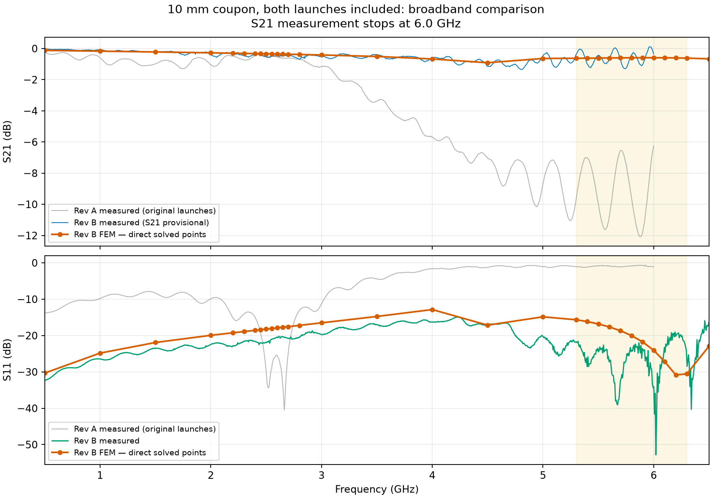
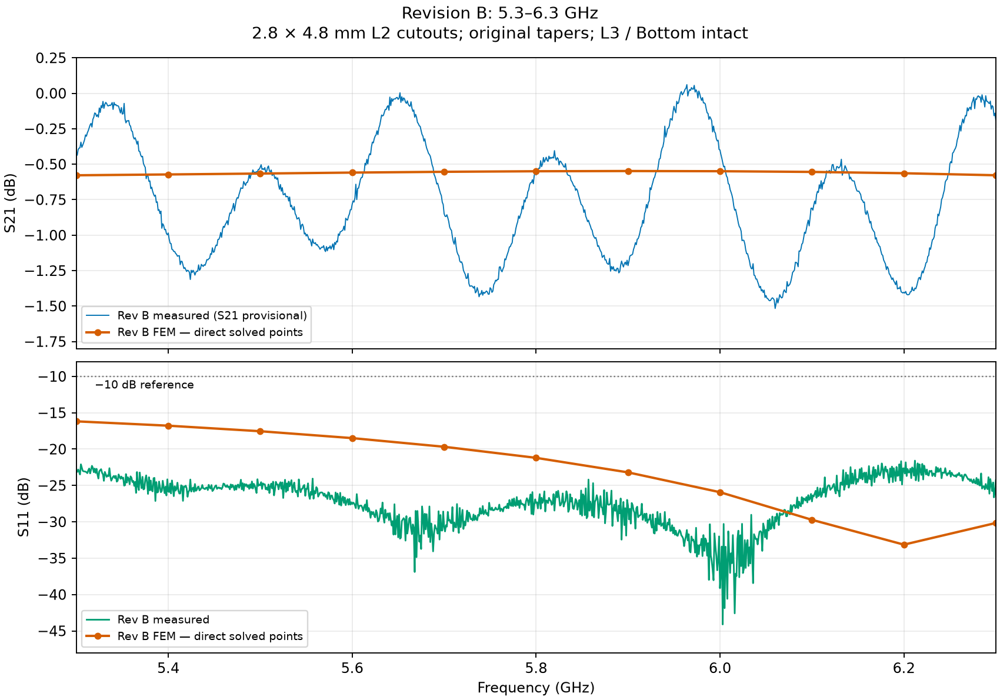

# Revision B coupon: simulation versus measurement

Initial measurement set (17:49–18:35 on 2026-11-01), preserved under the renamed `_0` files. For the later same-calibration line comparison, see [Line parameters and solder mask](12_LINE_PARAMETERS_AND_MASK.md).

**Verdict: the launch redesign works, and matching is good.** Broadband S11 stays below **-14.9 dB over 0.1–6.5 GHz**. In 5.3–6.3 GHz, worst S11 is **-21.6 dB in the narrow sweep** and **-19.0 dB in the broad sweep**. S21 remains provisional.

**S11 was measured with an external termination at the far end of the coupon**, using the two 1001-point S1P sweeps. S21 comes from the earlier two-port measurements.

| Dataset | Band, GHz | Median S21, dB | S21 min…max, dB | Worst S11, dB |
|---|---|---:|---:|---:|
| Measured S21, broad sweep (provisional) | 0.5–6 | -0.49 | -1.35…0.11 | — |
| Measured S11, external termination / broad sweep | 0.5–6.5 | — | — | -14.91 |
| FEM, standard mesh | 0.5–6.5 | -0.51 | -0.91…-0.12 | -12.85 |
| Measured S11, external termination / broad sweep overlap | 5.3–6.3 | — | — | -19.02 |
| Measured S21, narrow sweep (provisional) | 5.3–6.3 | -0.75 | -1.52…0.06 | — |
| Measured S11, external termination | 5.3–6.3 | — | — | -21.59 |
| FEM, finer mesh | 5.3–6.3 | -0.56 | -0.58…-0.55 | -16.18 |

At **5.8 GHz**, measured / simulated **S11 = -27.4 / -21.2 dB**. Earlier measured / simulated **S21 = -0.58 / -0.55 dB**, but its ripple must not be attributed to the PCB before checking the transmission measurement. Ranges include every sample in each stated band; medians use each dataset's own grid. The narrow-sweep worst reflection corresponds to **0.69% reflected power**.

The new broad sweep covers **0.1–6.5 GHz**; its worst S11 is **-14.91 dB at 4.2344 GHz**. The plot/table compare **0.5–6.5 GHz**, where broadband FEM exists. Its 5.3–6.3 GHz worst S11 differs from the narrow sweep by **2.57 dB**; retain both results rather than treating them as identical repeats. Both measured worst-band values are better than the finer FEM prediction of **−16.2 dB**, although the curve shapes differ.

Comparison uses the selected **2.8 × 4.8 mm L2 cutouts, original tapers, L3 / Bottom intact**, εr=4.5, tanδ=0.02 and simplified BWSMA connectors. Broadband FEM: [standard mesh, 31 points over 0.5–6.5 GHz](07_BROADBAND_CHECK.md); narrow-band FEM: [finer mesh, 11 points](08_MESH_REFINEMENT.md). Lines join solved points and do not imply dense FEM sampling. Both measurement and simulation use 50 Ω references and include both launches; no per-launch loss is inferred.

The **earlier S2P** broadband filename says 100 MHz–6.5 GHz, but its recorded frequencies cover **10 MHz–6.0 GHz**; its S21 trace ends at 6.0 GHz. The earlier narrow S2P contains **1001 points over 5.3–6.3 GHz**. Its S21 briefly exceeds 0 dB, indicating measurement uncertainty. No smoothing, calibration correction or de-embedding was applied. The S2P files contain zero-filled S12/S22 columns; the S1P files contain only input reflection. None establishes reciprocity or output matching.

Measurements: [earlier broad S2P](measurements/coupon_revB_7628_horizontal_10mm_100Mhz_6.5GHz_nanoVNA_0.s2p) · [earlier narrow S2P](measurements/coupon_revB_7628_horizontal_10mm_5.3_6.3GHz_nanoVNA_0.s2p) · [externally terminated narrow S1P](measurements/coupon_revB_7628_horizontal_10mm_5.3_6.3GHz_nanoVNA_terminated_0.s1p) · [externally terminated broad S1P](measurements/coupon_revB_7628_horizontal_10mm_100MHz_6.5GHz_nanoVNA_terminated_0.s1p). [Computed metrics and source hashes](assets/revb_measurements/metrics.json).

Regenerate from `Frontend/emerge` with `python -m coupon_10mm.report_revb_measurements` (using the project venv). [Coupon overview](index.md).
