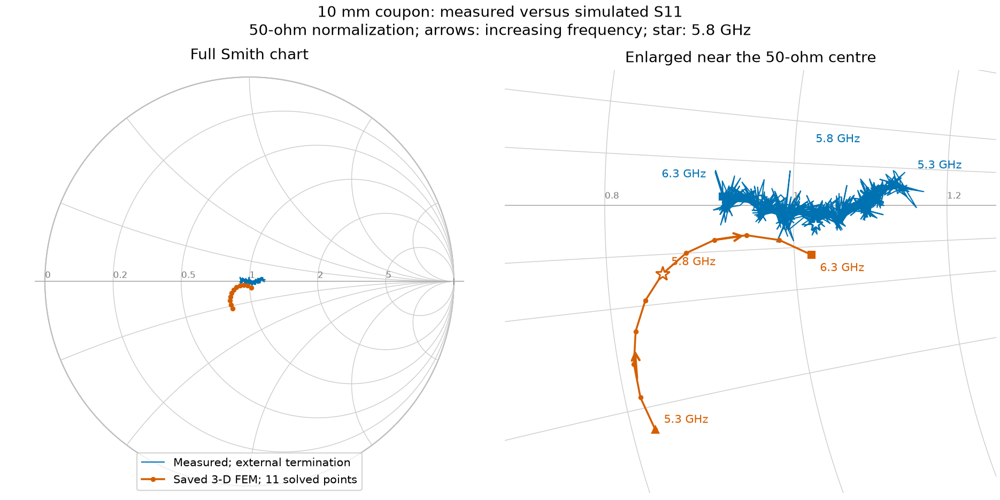

# Line parameters and solder mask: revision B

**The measured wave travels slightly slower than our 2-D model predicts.** Measured εeff is **3.34–3.45**, compared with **3.25 in simulation**. The short coupon matches 50 Ω well, but the 3-D model does not reproduce its measured impedance exactly. Solder mask adds delay.

## Measurements

We compared the **10, 40 and 90 mm bare lines**, plus the **40 mm masked line**, over **5.3–6.3 GHz**, using the same calibration. S11 was measured with an external termination at the far end. S21 was measured with NanoVNA port 2 connected.

The plots use the remeasured 10 mm reference and the replacement masked-line S21. Older measurements ending in _0 are excluded.

| Line | Median S21, dB | Worst S11, dB |
|---|---:|---:|
| 10 mm | -0.80 | -22.2 |
| 40 mm | -2.13 | -11.9 |
| 90 mm | -3.48 | -14.9 |
| 40 mm masked | -2.07 | -12.4 |

## Effective permittivity and line loss

**εeff tells us how slowly the wave travels along the microstrip.** It includes the fields in both the PCB and the air, so it is not the PCB material's bulk Dk.

**Left:** the coloured curves come from the measurements. The black dashed line is our 2-D simulation, **εeff = 3.249**. The 40/10 mm pair gives **3.34**, and the 90/10 mm pair gives **3.45**. Ideally they would agree. I would use the longer pair as the better estimate because the same launch error has less influence over 80 mm than over 30 mm. Its value is **6.1% above simulation**.

**Right:** dividing the longer line's S21 by the short line's S21 estimates the loss of the extra track. The 90/10 mm pair gives a median of **0.33 dB/cm**; 40/10 mm gives **0.46 dB/cm**. The difference and ripple mean that launch and measurement errors have not cancelled completely. These are estimates of total line loss, not dielectric loss alone.

### How εeff is calculated

A wave loses amplitude and accumulates phase as it travels:

$$
V(z)=V_0e^{-(\alpha+j\beta)z},\qquad
S_{21}(\ell)\approx A(f)e^{-\gamma\ell}.
$$

Here $\alpha$ describes attenuation, $\beta$ describes phase change per metre, and $A(f)$ represents the two launches. If the launches are the same on both coupons, dividing their transmissions approximately removes $A(f)$:

$$
R=\frac{S_{21,L}}{S_{21,S}}\approx e^{-\gamma\Delta\ell},\qquad
\phi=\operatorname{unwrap}\arg R-2\pi N,\qquad
\beta\approx-\frac{\phi}{\Delta\ell}.
$$

The extra phase $\phi$ belongs to the extra length $\Delta\ell$. From $v_p=\omega/\beta=c/\sqrt{\varepsilon_{\mathrm{eff}}}$, we obtain:

$$
\boxed{\varepsilon_{\mathrm{eff}}(f)\approx
\left(\frac{-c\phi}{2\pi f\Delta\ell}\right)^2},\qquad
\alpha_{\mathrm{dB/mm}}\approx\frac{-20\log_{10}|R|}{1000\Delta\ell}
\quad(\Delta\ell\text{ in m}).
$$

The PCB track lengths are **14.8, 44.8 and 94.8 mm**, so the extra lengths are **30 and 80 mm**.

**How we choose N.** Start at the first measured frequency, **5.3 GHz**. Our 2-D simulation predicts εeff ≈ 3.25, giving an approximate wavelength:

$$
\lambda_g\approx\frac{c}{f\sqrt{\varepsilon_{eff,2D}}}
=\frac{299\,792\,458}{5.3\times10^9\sqrt{3.249}}
\approx 31.4\ \mathrm{mm}.
$$

We compare **S21 phase at 5.3 GHz for two different coupons**. The phase of their ratio is the difference between the two measured phases, wrapped into −180°…+180°:

$$
\phi_{wrapped}=\arg\left(\frac{S_{21,L}}{S_{21,10}}\right)
=\operatorname{wrap}_{[-180^\circ,180^\circ]}
\left(\arg S_{21,L}-\arg S_{21,10}\right).
$$

- **40/10 mm:** the measured S21 phases are **+111.2° for 40 mm** and **+97.8° for 10 mm**. Their difference is **+111.2° − (+97.8°) = +13.4°**. The extra 30 mm is about **0.96 wavelengths**, so we expect about **-344°** of extra phase. Subtracting one turn from the measured difference gives **+13.4° − 360° = -346.6°**. Therefore **N=1**.
- **90/10 mm:** the measured S21 phases are **-128.5° for 90 mm** and **+97.8° for 10 mm**. Their difference is **-226.3°**, which wraps to **+133.7°**. The extra 80 mm is about **2.55 wavelengths**, so we expect about **-918°**. Subtracting three turns from the wrapped difference gives **+133.7° − 1080° = -946.3°**. Therefore **N=3**.

N counts the turns missing from the reported angle; it is **not** the integer part of length/wavelength. We choose it once at 5.3 GHz, then unwrap the rest of the sweep continuously. The 2-D prediction selects the whole-turn correction only; it does not force the measured εeff to equal the simulated value. A wrong turn count or unequal launches would bias the result. This is a simple line-ratio estimate, not a full [multiline TRL calibration](https://scikit-rf-official.readthedocs.io/en/v2.0.0/examples/metrology/Multiline%20TRL.html).

### What the fitted line means

For each pair, we fit a straight line through **all 1,001 phase samples**:

$$
\phi(f)\approx a+b(f-5.8\,\mathrm{GHz}),\qquad
\tau=-\frac{b}{2\pi},\qquad
n_g^2=\left(\frac{c\tau}{\Delta\ell}\right)^2.
$$

For the delay equation, $b$ is in radians/Hz. The intercept $a$ is free. **This fit checks the delay; the εeff curves above use measured phase directly.** The lower plots show what the straight line misses.

| Pair | Median phase εeff | Phase εeff range | Added delay, ps | Group-index squared |
|---|---:|---:|---:|---:|
| 40 / 10 mm | 3.34 | 3.27–3.52 | 191.0 | 3.64 |
| 90 / 10 mm | 3.45 | 3.42–3.49 | 485.6 | 3.31 |

The last column comes from the slope. Phase and group speed can differ when speed changes with frequency. Measurement errors also affect the slope, so the two estimates should not be treated as interchangeable.

## Impedance: measurement versus simulation

There are two different quantities here:

- **$Z_c$:** the characteristic impedance of the uniform track.
- **$Z_{in}$:** the impedance seen by the VNA when looking into the whole coupon, including connectors, launches and the far-end load.

Our existing [2-D solver](https://github.com/olddudealex/funrad/blob/main/Frontend/emerge/simulation/coupled_2d.py) predicts **$Z_c=49.38$ Ω** and **$\varepsilon_{eff}=3.249$** for the bare track. It calculates capacitance once with the PCB dielectric, $C'$, and once with air, $C'_{air}$:

$$
\varepsilon_{eff}=\frac{C'}{C'_{air}},\qquad
Z_c=\frac{1}{c\sqrt{C'C'_{air}}}.
$$

Inputs: **370 µm width, 35 µm copper, 210.4 µm dielectric, εr=4.5, no mask**. This is the same 2-D method used earlier, now applied to one coupon line. It models the straight track above L2; it does not model the launches or frequency dispersion. The selected grid is 5 µm, with 2.5 mm side padding and 4 mm air above the strip. [Grid and box checks](assets/line_parameters/metrics.json) are saved with the results.

To compare the complete coupon, we convert both measured and simulated S11 to input impedance:

$$
\Gamma=\frac{Z_{in}-50}{Z_{in}+50}
\quad\Rightarrow\quad
\boxed{Z_{in}=50\frac{1+S_{11}}{1-S_{11}}}.
$$

At **5.8 GHz**, the measurement gives **51.3-1.2j Ω**, while simulation gives **42.7-3.5j Ω**. The measurement is closer to 50 Ω. The model does not predict the measured curve accurately.

The Smith chart shows the same S11 data. **Its centre is a perfect 50 Ω match.** The right panel is enlarged; arrows point towards higher frequency, and stars mark 5.8 GHz.

We reuse only the saved **10 mm, 2.8 × 4.8 mm L2-cutout, finer-mesh 3-D simulation**. Its connector and solder geometry are simplified. Also, the measured and simulated reference planes—the physical points where S11 is defined—have not been aligned exactly. Both can affect this comparison; no phase adjustment was made to force agreement.

The measured εeff helps check wave speed. **It does not give us a measured $Z_c$.** The measured $Z_{in}$ above should therefore not be read as the track's characteristic impedance.

## Solder mask

The masked 40 mm line adds **19.9° of phase lag at 5.8 GHz**: the wave travels more slowly. Assuming 40 mm of changed mask coverage and equal launches,

$$
\Delta n=\frac{-c\arg(S_{21,m}/S_{21,b})}{2\pi f\,0.040},\qquad
\varepsilon_{eff,m}\approx
\left(\sqrt{\varepsilon_{eff,b}}+\Delta n\right)^2.
$$

This gives **εeff 3.45 → 3.72 at 5.8 GHz**. It describes the coated microstrip, not the mask material's own Dk. The median extra loss is **-0.14 dB**, with differences from **-0.59 to 0.28 dB** across the band. Some values are negative, so this measurement cannot reliably separate the mask's added loss from mismatch and coupon differences.

## Files and reproduction

| Coupon | S21 | S11 with external termination |
|---|---|---|
| 10 mm | [S21](measurements/coupon_revB_7628_horizontal_10mm_5.3_6.3GHz_nanoVNA.s2p) | [S11](measurements/coupon_revB_7628_horizontal_10mm_5.3_6.3GHz_nanoVNA_terminated.s1p) |
| 40 mm | [S21](measurements/coupon_revB_7628_horizontal_40mm_5.3_6.3GHz_nanoVNA.s2p) | [S11](measurements/coupon_revB_7628_horizontal_40mm_5.3_6.3GHz_nanoVNA_terminated.s1p) |
| 90 mm | [S21](measurements/coupon_revB_7628_horizontal_90mm_5.3_6.3GHz_nanoVNA.s2p) | [S11](measurements/coupon_revB_7628_horizontal_90mm_5.3_6.3GHz_nanoVNA_terminated.s1p) |
| 40 mm masked | [S21](measurements/coupon_revB_7628_horizontal_40mm_masked_5.3_6.3GHz_nanoVNA.s2p) | [S11](measurements/coupon_revB_7628_horizontal_40mm_masked_5.3_6.3GHz_nanoVNA_terminated.s1p) |

[Calculated results and file hashes](assets/line_parameters/metrics.json) · [10 mm 3-D simulation](08_MESH_REFINEMENT.md) · [Coupon overview](index.md)

From Frontend/emerge, use the project venv to run python -m coupon_10mm.report_line_parameters. If the 2-D reference needs rebuilding, first run python -m coupon_10mm.line_cross_section.
