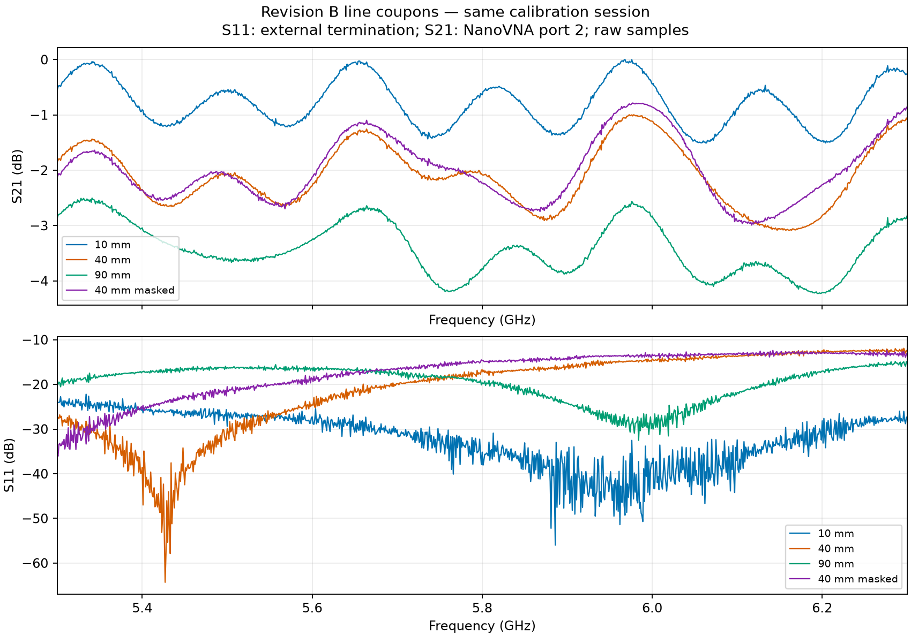
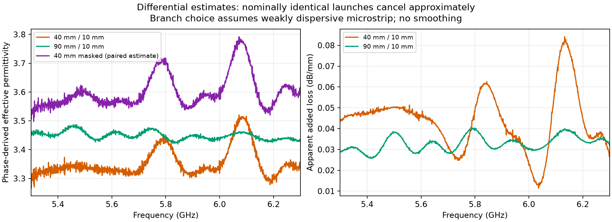
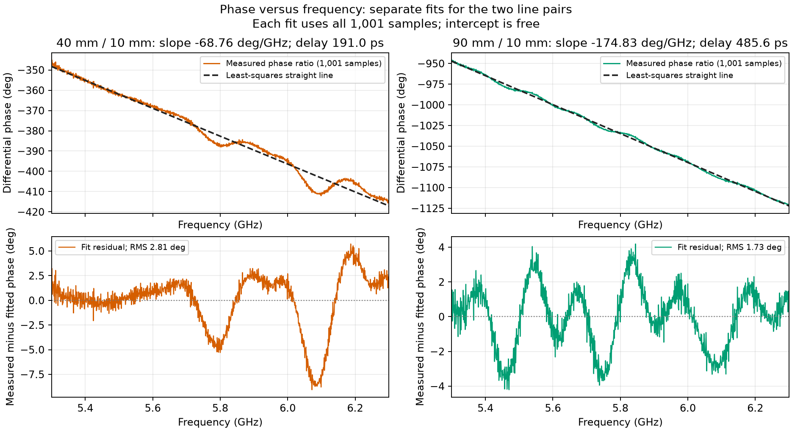
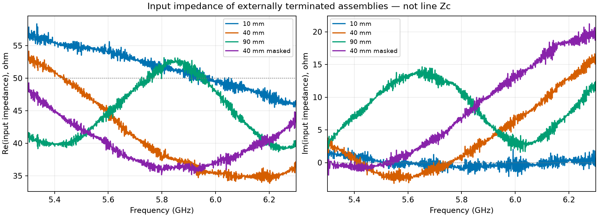

# Line parameters and solder mask: revision B

**Result:** unmasked effective permittivity is approximately **3.34–3.45**. Prefer the 90/10 mm estimate: its larger length difference reduces launch sensitivity. Mask adds delay. Characteristic impedance is **not uniquely extracted**; a nominal-geometry thin-strip estimate is **about 51 Ω**.

## Measurements

Current line measurements use the same calibration per the measurement record; the **40 mm masked S21 was remeasured to replace a discontinuous trace**. **S11 uses external terminations; S21 uses NanoVNA port 2.** The new 10 mm S21 filename says “100Mhz_6.5GHz” but contains **5.3–6.3 GHz**. All current inputs are linked below without the _0 suffix; older 10 mm _0 measurements are excluded.

| Line | Median S21, dB | Worst S11, dB | Re(Zin), Ω | Im(Zin), Ω |
|---|---:|---:|---:|---:|
| 10 mm | -0.80 | -22.2 | 45.5…58.4 | -2.1…2.3 |
| 40 mm | -2.13 | -11.9 | 33.8…54.2 | -3.2…16.6 |
| 90 mm | -3.48 | -14.9 | 38.7…53.2 | 1.6…14.6 |
| 40 mm masked | -2.07 | -12.4 | 35.2…49.3 | -1.9…21.2 |

## Effective Dk: derivation

A forward wave is $V(z)=V_0e^{-(\alpha+j\beta)z}$. For approximately matched lines with equal launches, $S_{21}(\ell)\approx A(f)e^{-\gamma\ell}$. Dividing cancels the common launch factor:

$$
R=\frac{S_{21,L}}{S_{21,S}}\approx e^{-\gamma\Delta\ell},\qquad
\phi=\operatorname{unwrap}\arg R-2\pi N,\qquad
\beta\approx-\frac{\phi}{\Delta\ell}.
$$

Since $v_p=\omega/\beta=c/\sqrt{\varepsilon_{\mathrm{eff}}}$,

$$
\boxed{\varepsilon_{\mathrm{eff}}(f)\approx
\left(\frac{-c\phi}{2\pi f\Delta\ell}\right)^2},\qquad
\alpha_{\mathrm{dB/mm}}\approx\frac{-20\log_{10}|R|}{1000\Delta\ell}
\quad(\Delta\ell\text{ in m}).
$$

Use $\Delta\ell=30/80$ mm: PCB track lengths are **14.8/44.8/94.8 mm** with equal launch regions. Phase branches **N=1/3** give a weakly dispersive microstrip index near 1.8, broadly consistent with phase-slope delay. This branch choice is an assumption. The ratio method approximates launch cancellation; **it is not multiline TRL**. [Propagation/phase relation](https://scikit-rf-official.readthedocs.io/en/v2.0.0/examples/metrology/Multiline%20TRL.html).

| Pair | Median phase εeff | Phase εeff range | Differential delay, ps | Group-index squared |
|---|---:|---:|---:|---:|
| 40 / 10 mm | 3.34 | 3.27–3.52 | 191.0 | 3.64 |
| 90 / 10 mm | 3.45 | 3.42–3.49 | 485.6 | 3.31 |

**What is fitted?** For each line pair separately, an unweighted least-squares straight line $\phi(f)\approx a+b(f-5.8\,\mathrm{GHz})$ uses **all 1,001 measured frequency samples** over 5.3–6.3 GHz, with a free intercept. This is not a fit through the three coupon lengths. The figure shows the measured phase ratios, fitted lines and residuals.

The fitted slope $b$ gives $\tau=-b/(2\pi)$ (with $f$ in Hz) and $n_g^2=(c\tau/\Delta\ell)^2$. It supplies the delay/group-index columns; the phase εeff curves above use the measured phase directly. **Group and phase indices differ under dispersion**; their disagreement and pair spread expose uncertainty. Effective ε includes air fields: **it is not bulk substrate Dk**. Added loss includes residual mismatch, not just dielectric loss.

## Impedance

From $\Gamma=(Z_{in}-50)/(Z_{in}+50)$,

$$
\boxed{Z_{in}=50\frac{1+S_{11}}{1-S_{11}}}.
$$

This is the **terminated assembly's input impedance**, including launches and load, not uniform-line $Z_c$. Separately loaded S11/S21 and zero-filled S12/S22 do not provide a full two-port matrix for unique de-embedding.

For a geometry estimate, $\beta=\omega\sqrt{L'C'}$, $Z_c=\sqrt{L'/C'}$, $L'\approx L'_{air}$ and $C'/C'_{air}\approx\varepsilon_{eff}$ give **$Z_c\approx Z_{air}/\sqrt{\varepsilon_{eff}}$**. The [Hammerstad–Jensen air-line model](https://qucs.sourceforge.net/tech/node75.html) gives

$$
u=\frac wh,\quad F=6+(2\pi-6)e^{-(30.666/u)^{0.7528}},\qquad
Z_{air}\approx\frac{376.73}{2\pi}\ln\left[\frac Fu+\sqrt{1+(2/u)^2}\right].
$$

With $w=0.370$ mm and $h=0.2104$ mm, $Z_{air}\approx95.6$ Ω and $Z_c\approx51.5$ Ω (90/10 phase estimate). **This neglects 35 µm copper thickness, etch shape, nearby ground and dispersion; it is not measured impedance.**

## Solder mask

The masked 40 mm coupon adds **19.9° phase lag at 5.8 GHz**. Assuming 40 mm changed coverage and equal launches, $\Delta n=-c\arg(S_{21,m}/S_{21,b})/(2\pi f\,0.040)$ and $\varepsilon_{eff,m}\approx(\sqrt{\varepsilon_{eff,b}}+\Delta n)^2$ give **3.45 → 3.72** at 5.8 GHz. This indicates dielectric loading, not the mask's own Dk. Median extra loss is **-0.14 dB**, but differences span **-0.59…0.28 dB**. Mask loss and impedance shift are not isolated from mismatch/coupon variation.

## Data

| Coupon | Transmission | Externally terminated reflection |
|---|---|---|
| 10 mm | [S21](measurements/coupon_revB_7628_horizontal_10mm_100Mhz_6.5GHz_nanoVNA.s2p) | [S11](measurements/coupon_revB_7628_horizontal_10mm_5.3_6.3GHz_nanoVNA_terminated.s1p) |
| 40 mm | [S21](measurements/coupon_revB_7628_horizontal_40mm_5.3_6.3GHz_nanoVNA.s2p) | [S11](measurements/coupon_revB_7628_horizontal_40mm_5.3_6.3GHz_nanoVNA_terminated.s1p) |
| 90 mm | [S21](measurements/coupon_revB_7628_horizontal_90mm_5.3_6.3GHz_nanoVNA.s2p) | [S11](measurements/coupon_revB_7628_horizontal_90mm_5.3_6.3GHz_nanoVNA_terminated.s1p) |
| 40 mm masked | [S21](measurements/coupon_revB_7628_horizontal_40mm_masked_5.3_6.3GHz_nanoVNA.s2p) | [S11](measurements/coupon_revB_7628_horizontal_40mm_masked_5.3_6.3GHz_nanoVNA_terminated.s1p) |

[Metrics and input hashes](assets/line_parameters/metrics.json). Regenerate from Frontend/emerge with the project venv: python -m coupon_10mm.report_line_parameters. [Overview](index.md).
